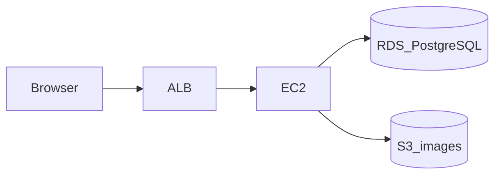

# 学習用SNS

Xのタイムラインに近い、学習用のWebアプリです。プログラムより先に、言葉・範囲・データ・画面・技術・インフラの前提を [ドキュメント](ドキュメント/README.md) で決めています。

利用者は受講生または個人です。1人で試すことも、複数のアカウントで互いの投稿にいいね・コメント・フォローすることも、同じ設計で扱います。

いまリポジトリにあるのは資料と、課題管理ボードから移した開発ルールです。画面（`frontend/`）と API（`backend/`）はまだありません。

| 層 | 場所 | いまあるもの |
|---|---|---|
| 資料 | `ドキュメント/` | 用語、要件、機能、画面、データ、技術、インフラ |
| 画面 | `frontend/` | 未作成。予定は React 19.3.0 / Vite 7.3.6 |
| API | `backend/` | 未作成。予定は Spring Boot 4.1.1 / Java 21 |
| 文章の保存 | PostgreSQL 16 | 未作成。開発中は Docker の `postgres:16-alpine`。AWS に載せる場合は RDS |
| 画像 | Amazon S3 | 保存先は決定。バケットの作成は未実施 |

言葉の意味は [用語定義書](ドキュメント/用語定義書.md)、何を作るかの正は [要件定義書](ドキュメント/要件定義書.md)、番号の正は [機能要件](ドキュメント/機能要件.md)、流れと完成条件の正は [機能定義](ドキュメント/機能定義/README.md) です。

---

## 1. 何を作るか

学校の学習課題として、要件を決めてから画面とデータを設計し、そのあと実装する流れを体験するために作ります。

ホームは「全体」と「フォロー中」のタブです。全体は全ユーザーの投稿、フォロー中は自分の投稿とフォローしているユーザーの投稿です。どちらも新しい順です。人を見つける手段は、ユーザー名と表示名の検索です。投稿本文は探しません。

ログインは JWT です。ユーザーは任意でアイコンと自己紹介を持てます。自分の投稿は編集と削除ができます。

Xとの違いは次の2点です。

- インプレッション数を表示しない。回数も保存しない
- リポスト（リツイート）や引用を作らない

画像の保存先は Amazon S3 です。API と PostgreSQL を AWS の EC2 と RDS に置き、入口を ALB にする作業は、まだ実施を決めていません。置く場合の箱の並びは [インフラ構成](ドキュメント/インフラ構成.md) です。

---

## 2. できること

詳細な流れは機能定義、受け入れの番号は機能要件を正とします。

### アカウント

| No. | できること | 画面 |
|---|---|---|
| A-1 | 表示名、ユーザー名、メールアドレス、パスワードで登録する。アイコンと自己紹介は任意。成功すると JWT を受け取り、全体タブへ進む | 新規登録 |
| A-2 | ユーザー名またはメールアドレスと、パスワードでログインする。成功すると JWT を返す | ログイン |
| A-3 | 画面の JWT を捨ててログアウトする | ログイン後の共通ヘッダー |
| A-4 | 自分のアイコンと自己紹介を保存する | 自分のプロフィール |

未ログインでは、投稿、コメント、いいね、フォロー、ユーザー検索はできません。パスワードはハッシュで保存し、平文は残しません。ログイン後の API は `Authorization: Bearer` で JWT を送ります。トークンは sessionStorage に置き、有効期限の仮値は24時間です。

### 投稿

| No. | できること | 画面 |
|---|---|---|
| P-1 | 本文1〜280文字で投稿する。画像は任意で1枚。JPEG、PNG、WebP。5MB以下。ファイルは S3 に置く | タイムライン |
| P-2 | 自分の投稿の本文を直す。画像は維持、差し替え、削除のいずれか | 自分の投稿カード |
| P-3 | 確認のあと、自分の投稿と、そのコメント、いいね、S3 の画像を消す | 自分の投稿カード |

### タイムライン

| No. | できること | 画面 |
|---|---|---|
| T-1 | 全ユーザーの投稿を新しい順に出す。開いた直後はこのタブ | タイムラインの全体 |
| T-2 | 自分の投稿と、フォロー中のユーザーの投稿を新しい順に出す | タイムラインのフォロー中 |
| T-3 | 投稿1件と、そのコメント欄を出す。フォローしていなくても詳細は開ける | 投稿詳細 |

### コメント

| No. | できること | 画面 |
|---|---|---|
| C-1 | 投稿に対して本文1〜280文字のコメントを1件追加する。画像は付けない。返信は作れない | 投稿詳細 |
| C-2 | その投稿のコメントを古い順に出す。書いた人のアイコンを出す | 投稿詳細 |

### いいね

| No. | できること | 画面 |
|---|---|---|
| L-1 | まだいいねしていない投稿に、自分のいいねを1件付ける | タイムライン、投稿詳細 |
| L-2 | 自分のいいねだけを外す。他のユーザーのいいねは残る | タイムライン、投稿詳細 |
| L-3 | いいね数とコメント数を出す。0も出す。表の列には持たず、行を数える | タイムライン、投稿詳細、プロフィール |

### フォローとユーザー検索

| No. | できること | 画面 |
|---|---|---|
| F-1 | ユーザー名と表示名の部分一致で探す。最大20件。投稿本文は探さない | ユーザー検索 |
| F-2 | アイコン、表示名、ユーザー名、自己紹介、フォロー数、フォロワー数、その人の投稿を出す | プロフィール |
| F-3 | 承認なしの片方向でフォローする。自分自身は不可 | 検索、プロフィール、一覧 |
| F-4 | 自分のフォローを外す。相手の投稿はフォロー中タブから外れる。全体タブには残る | 検索、プロフィール、一覧 |
| F-5 | その人がフォローしている人を、関係が新しい順に出す | フォロー中一覧 |
| F-6 | その人をフォローしている人を、関係が新しい順に出す | フォロワー一覧 |
| F-7 | フォロー数とフォロワー数を出す。行を数える | プロフィール |

検索の並びは、ユーザー名の前方一致、表示名の前方一致、その他の部分一致です。同じグループの中はユーザー名の昇順です。21件目がありうるときは20件と、条件を絞る案内を出します。

---

## 3. 画面

ログイン後の画面は、アプリ名、ユーザー検索、自分のプロフィール、ログアウトを持つ共通ヘッダーを使います。

| 画面ID | 画面名 | 役割 |
|---|---|---|
| SCR-01 | ログイン | 入る |
| SCR-02 | 新規登録 | アカウントを作る |
| SCR-03 | タイムライン | 投稿の作成。全体とフォロー中の切り替え |
| SCR-04 | 投稿詳細 | 投稿1件、コメント、いいね。自分の投稿なら編集と削除 |
| SCR-05 | ユーザー検索 | 最大20件の結果 |
| SCR-06 | プロフィール | アイコン、自己紹介、フォロー、その人の投稿 |
| SCR-07 | フォロー中一覧 | その人がフォローしている人 |
| SCR-08 | フォロワー一覧 | その人をフォローしている人 |

部品の正は [画面設計書](ドキュメント/画面設計書.md) です。インプレッションとリポストの部品は置きません。コメントにいいねボタンは置きません。

---

## 4. データ

文章と関係は PostgreSQL の5表です。画像ファイルは表に入れず、S3 のオブジェクトキーだけを投稿に持たせます。

| 表 | 意味 |
|---|---|
| users | ユーザー。ユーザー名とメールは、大文字小文字を区別せず一意。bio と icon_key は任意 |
| posts | 投稿。本文は必須。`image_key` は任意。`updated_at` を持つ |
| comments | 投稿への1段階のコメント。親コメントの列は無い |
| likes | いいね。`(post_id, user_id)` が一意 |
| follows | フォロー。`(follower_id, followee_id)` が一意。自分自身の行は不可 |

いいね数、コメント数、フォロー数、フォロワー数の列は持ちません。関係の図は [ER図](ドキュメント/ER図.md)、列と制約の正は [データベース設計](ドキュメント/データベース設計.md) です。

---

## 5. 技術

課題管理ボードと同じ版を使います。実装時に、この範囲のより新しい版へは上げません。正は [技術スタック](ドキュメント/技術スタック.md) です。

| 技術 | 版 |
|---|---|
| React / react-dom | 19.3.0（宣言は `^19.1.1`） |
| Vite | 7.3.6（宣言は `^7.1.5`） |
| @vitejs/plugin-react | 5.2.0（宣言は `^5.0.2`） |
| Node.js | 20.19.0 以上、または 22.12.0 以上 |
| Java | 21（Microsoft Build of OpenJDK 21.0.12） |
| Spring Boot | 4.1.1 |
| Maven | 3.9.16（Wrapper 3.3.4） |
| PostgreSQL | 16（開発中は `postgres:16-alpine`） |
| PostgreSQL JDBC | Spring Boot 4.1.1 が管理する版 |

画面は JavaScript、API は Java です。Next.js、TypeScript、ORM は使いません。ログインは JWT（jjwt）です。サーバセッションは使いません。開発中のポートは API が 8080、画面が 5173 です。別の番号へ移して起動しません。

---

## 6. インフラの前提

S3 を画像の保存先にすることは決まっています。AWS にサーバを構築するかは未決定です。載せる場合は、次の並びです。

入口は ALB、画面と API は EC2 の1台、PostgreSQL は RDS、画像は非公開の S3 です。開発中は ALB、EC2、RDS を使わず、画像だけ S3 を使います。AWS のリソースが未作成であることは、最初の完成の不合格にしません。

---

## 7. 資料の読み順

初めて読むときは [ドキュメントの一覧](ドキュメント/README.md) の上から順に見ます。

| 順番 | 資料 | 役割 |
|---|---|---|
| 1 | [用語定義書](ドキュメント/用語定義書.md) | 呼び方の辞書 |
| 2 | [要件定義書](ドキュメント/要件定義書.md) | 何を作り、何を作らないか |
| 3 | [機能要件](ドキュメント/機能要件.md) | A / P / T / C / L / F の番号一覧 |
| 4 | [機能定義](ドキュメント/機能定義/README.md) | 機能ごとの流れと完成条件 |
| 5 | [ER図](ドキュメント/ER図.md) | 5表の関係 |
| 6 | [データベース設計](ドキュメント/データベース設計.md) | 列、型、制約 |
| 7 | [技術スタック](ドキュメント/技術スタック.md) | 採用する技術と版 |
| 8 | [画面設計書](ドキュメント/画面設計書.md) | 画面の部品と遷移 |
| 9 | [インフラ構成](ドキュメント/インフラ構成.md) | ALB、EC2、RDS、S3。構築は未決定 |

---

## 8. 対象外

インプレッション、リポスト、引用、おすすめ順、投稿本文の検索、ハッシュタグ、コメントへの返信、コメントへのいいね、コメントの編集と削除、フォローの承認、ブロック、通知、ダイレクトメッセージ、複数画像、動画、スマートフォン専用アプリは、今回作りません。必要になったら要件定義書を改訂してから追加します。

---

## 9. Git の入れ方

既定ブランチは `main` です。資料の初回だけ `main` に直接入れています。それ以降は、課題管理ボードと同じ順です。

1. Issue を作る（`gh issue create`）
2. `main` から `feature/<issue番号>-<短い名前>` などのブランチを切る
3. そのブランチへコミットして push し、Pull Request を作る。本文に `Closes #<番号>` を書く
4. Pull Request をマージして `main` に入れる。レビュー人数は要求しない

Pull Request をマージすると、作業ブランチは自動で削除されます。

リポジトリは公開です。`main` への直接 push、force push、`main` の削除は、ruleset `protect-main` が拒みます。入れるときは Pull Request が必要です。レビュー人数は要求しません。ブランチ名のチェックが通ってからマージできます。手順の正は [.cursor/rules/git-workflow.mdc](.cursor/rules/git-workflow.mdc) です。

---

## 10. 経緯

| 日付 | 内容 |
|---|---|
| 2026年10月30日 | 全体タイムライン案を `docs/` に書いた |
| 2026年10月30日 | 課題管理ボードの資料構成に合わせ、`ドキュメント/` を正とした。フォロー、ユーザー検索、S3、ALB / EC2 / RDS の前提を加えた |
| 2026年10月30日 | 技術の版を課題管理ボードと同じ指定にした。スキルとルールを移し、この README を要件と機能定義に合わせて書いた |
| 2026年10月30日 | リポジトリを公開し、`main` への直接 push を拒む ruleset `protect-main` を有効にした |
| 2026年10月30日 | 主な機能を、JWT、投稿の編集と削除、全体とフォロー中のタブ、アイコンと自己紹介に合わせた |
