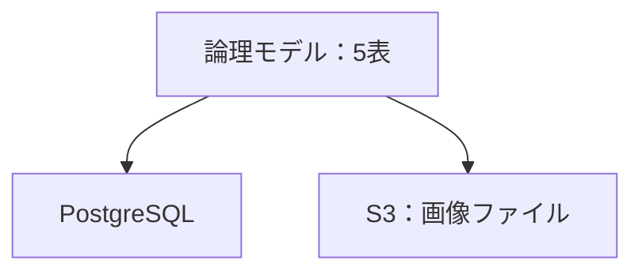
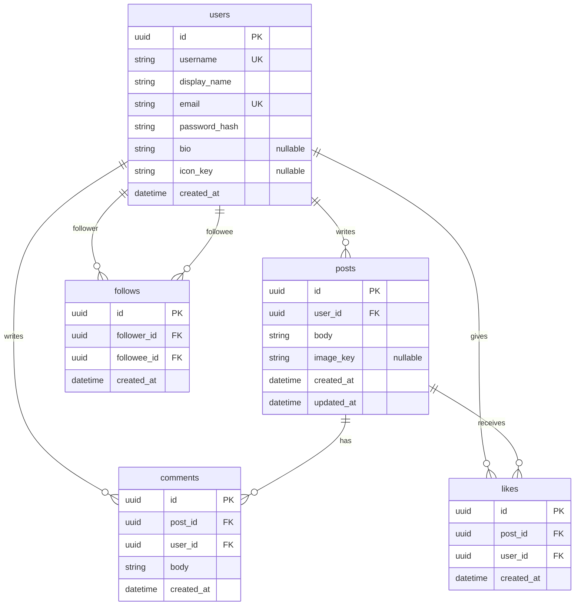

# ER図

| 項目 | 内容 |
|---|---|
| 文書名 | ER図 |
| 対象システム | 学習用SNS（X風のタイムラインアプリ） |
| 版 | 1.1 |
| 作成日 | 2026年10月30日 |
| 改訂日 | 2026年10月30日 |
| 作成者 | nsb |
| 関連資料 | 用語定義書、要件定義書、データベース設計、機能要件 |
| 目的 | ユーザー、投稿、コメント、いいね、フォローの関係を図で示す |

この資料は論理データモデルの図です。表の項目・型・制約の正は「データベース設計」とします。  
本実装の保存は PostgreSQL の5表です。画像ファイル本体は表に入れません。

---

## 1. この図の位置づけ

| 種類 | 内容 |
|---|---|
| この ER 図 | 画面の言葉と、PostgreSQL の5表に対応する論理モデル |
| 本実装 | PostgreSQL。users / posts / comments / likes / follows |
| 画像 | S3 のオブジェクト。posts.image_key が指す |

---

## 2. 論理 ER 図

`follows` は users に2本つながる。follower がフォローする側、followee がフォローされる側である。

---

## 3. エンティティ

| エンティティ | 意味 | 画面上の呼び方 |
|---|---|---|
| users | 登録済みの利用者 | ユーザー |
| posts | 本文と、任意の画像キー | 投稿 |
| comments | 投稿に対する1段階の本文 | コメント |
| likes | ユーザーと投稿の組のいいね | いいね |
| follows | ユーザーからユーザーへの片方向のフォロー | フォロー |

---

## 4. リレーション（多重度）

| 親 | 子 | 多重度 | 意味 |
|---|---|---|---|
| users | posts | 1 対 0以上 | 1人が複数の投稿を書く |
| users | comments | 1 対 0以上 | 1人が複数のコメントを書く |
| users | likes | 1 対 0以上 | 1人が複数の投稿にいいねする |
| users | follows（follower） | 1 対 0以上 | 1人が複数人をフォローする |
| users | follows（followee） | 1 対 0以上 | 1人が複数人からフォローされる |
| posts | comments | 1 対 0以上 | 1投稿に複数のコメントが付く |
| posts | likes | 1 対 0以上 | 1投稿に複数人のいいねが付く |

画像用の表は作らない。1投稿につき画像は最大1つなので、posts の任意項目にする。

---

## 5. 件数と一意

次の数は列に持たない。表示のときに行を数える。

| 表示 | 数えるもの |
|---|---|
| いいね数 | その投稿の likes |
| コメント数 | その投稿の comments |
| フォロー数 | follower_id がそのユーザーの follows |
| フォロワー数 | followee_id がそのユーザーの follows |

一意にする組は次のとおり。

| 表 | 組 | 意味 |
|---|---|---|
| likes | post_id と user_id | 1人が1投稿にいいねは1件 |
| follows | follower_id と followee_id | 1人が1人をフォローするのは1件 |

follows は、follower_id と followee_id が同じ行を許さない。

---

## 6. 持たない関係

次の表や列は、この図に足さない。

- インプレッション、閲覧
- リポスト、引用
- コメントの親コメント
- コメントへのいいね
- 件数のカウンタ
- 通知、ダイレクトメッセージ
- ブロック、ミュート、フォロー申請

---

## 7. 改訂履歴

| 版 | 日付 | 内容 |
|---|---|---|
| 1.0 | 2026年10月30日 | 初版。follows を加え、画像は posts の任意キーにした |
| 1.1 | 2026年10月30日 | users に自己紹介とアイコン、posts に updated_at を加えた |
