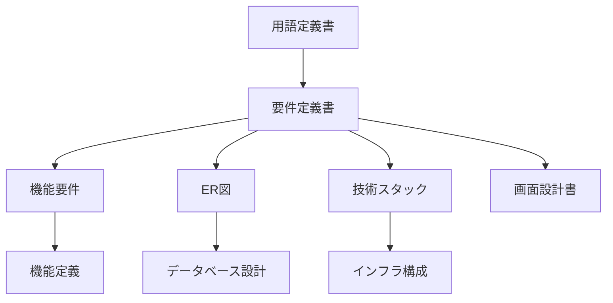

# ドキュメント一覧

学習用SNS（X風のタイムラインアプリ）の資料です。プログラムより先に、言葉・範囲・データ・画面・技術・インフラの前提をこのフォルダで決めています。

利用者は受講生または個人です。複数人がそれぞれのアカウントで投稿し、フォローし、コメントし、いいねします。画面は React 19.3.0（Vite 7.3.6）、API は Spring Boot 4.1.1（Java 21）、文章の保存は PostgreSQL 16、画像は Amazon S3 です。版の正は [技術スタック.md](./技術スタック.md) の「採用する版」です。AWS にサーバを置くかは未決定です。置く場合の前提は [インフラ構成.md](./インフラ構成.md) の ALB、EC2、RDS、S3 です。

プロジェクト全体の入口は、リポジトリ直下の [README.md](../README.md) です。このファイルは、資料の読み順と、各資料がどの約束を持つかを示します。課題管理ボードの `ドキュメント/README.md` と同じ役割です。

いま実装されている画面と API はありません。完成条件は [要件定義書.md](./要件定義書.md) 第11章です。

---

## 1. このシステムの約束（要約）

正は要件定義書と機能定義です。ここは資料を開く前の索引です。

ホームは全体タブとフォロー中タブです。全体は全ユーザーの投稿、フォロー中は自分の投稿とフォローしているユーザーの投稿を、新しい順に並べます。フォローは片方向で、相手の承認は要りません。自分自身はフォローできません。フォローを外すと、相手の投稿はフォロー中タブから外れます。全体タブと投稿の行は残ります。

ログインは JWT です。自分の投稿は編集と削除ができます。ユーザーは任意のアイコンと自己紹介を持ちます。

人の見つけ方はユーザー検索です。ユーザー名と表示名の部分一致で、最大20件です。投稿本文は探しません。並びは、ユーザー名の前方一致、表示名の前方一致、その他の部分一致です。

コメントは投稿に対する1段階です。コメントへの返信も、コメントへのいいねもありません。いいねは投稿だけです。1人につき1投稿へ1件で、付け外しができます。いいね数、コメント数、フォロー数、フォロワー数は表に保存せず、行を数えます。

インプレッション数は出しません。リポストは作りません。

| 分類 | 番号 | 定義 |
|---|---|---|
| アカウント | A-1〜A-4 | [機能定義/アカウント.md](./機能定義/アカウント.md) |
| 投稿 | P-1〜P-3 | [機能定義/投稿.md](./機能定義/投稿.md) |
| タイムライン | T-1〜T-3 | [機能定義/タイムライン.md](./機能定義/タイムライン.md) |
| コメント | C-1〜C-2 | [機能定義/コメント.md](./機能定義/コメント.md) |
| いいね | L-1〜L-3 | [機能定義/いいね.md](./機能定義/いいね.md) |
| フォローとユーザー検索 | F-1〜F-7 | [機能定義/フォロー.md](./機能定義/フォロー.md) |

番号の一覧は [機能要件.md](./機能要件.md) です。

---

## 2. どの順で読むか

初めて読むときは上から順に見ます。目的が決まっているときは、次の節のグループから入ってください。

| 順番 | 資料 | 役割 |
|---|---|---|
| 1 | [用語定義書.md](./用語定義書.md) | ユーザー、投稿、フォローなどの呼び方を揃える辞書 |
| 2 | [要件定義書.md](./要件定義書.md) | 何を作るか、何を作らないか。背景、利用者、例外、非機能、技術とインフラの全体 |
| 3 | [機能要件.md](./機能要件.md) | できることを A / P / T / C / L / F の番号で引く一覧 |
| 4 | [機能定義/README.md](./機能定義/README.md) | 機能ごとの定義書への入口。流れと完成条件 |
| 5 | [ER図.md](./ER図.md) | ユーザー、投稿、コメント、いいね、フォローの関係図 |
| 6 | [データベース設計.md](./データベース設計.md) | 表の項目、型、制約 |
| 7 | [技術スタック.md](./技術スタック.md) | 採用する技術、採用しない技術。版は課題管理ボードと同じ |
| 8 | [画面設計書.md](./画面設計書.md) | 画面の配置、部品の役割、画面遷移 |
| 9 | [インフラ構成.md](./インフラ構成.md) | ALB、EC2、RDS、S3 の構成図。構築そのものは未決定 |

機能ごとの定義書は次のとおりです。

| 資料 | 機能No. | 内容 |
|---|---|---|
| [機能定義/アカウント.md](./機能定義/アカウント.md) | A-1〜A-4 | 登録、JWT ログイン、ログアウト、アイコンと自己紹介 |
| [機能定義/投稿.md](./機能定義/投稿.md) | P-1〜P-3 | 本文と任意画像1枚。自分の投稿の編集と削除 |
| [機能定義/タイムライン.md](./機能定義/タイムライン.md) | T-1〜T-3 | 全体タブ、フォロー中タブ、投稿詳細 |
| [機能定義/コメント.md](./機能定義/コメント.md) | C-1〜C-2 | 投稿への1段階。古い順 |
| [機能定義/いいね.md](./機能定義/いいね.md) | L-1〜L-3 | 投稿への付け外しと、行を数えた件数 |
| [機能定義/フォロー.md](./機能定義/フォロー.md) | F-1〜F-7 | 検索の一致と20件、フォロー、一覧、プロフィール |

---

## 3. 目的から資料を選ぶ

### 言葉と範囲

用語定義書で呼び方を固定し、要件定義書で全体の約束を決めます。番号で引く一覧は機能要件、機能ごとの流れと完成条件は機能定義です。要件定義書と機能の資料が、「何を作るか」の正です。

画面は8枚です。ログイン、新規登録、タイムライン、投稿詳細、ユーザー検索、プロフィール、フォロー中一覧、フォロワー一覧です。

### データ

関係は ER図、項目と制約はデータベース設計です。保存は PostgreSQL の users、posts、comments、likes、follows の5表です。画像ファイル本体は表に入れず、posts の `image_key` だけを任意で持たせ、ファイルは S3 に置きます。件数の列は持ちません。

### 技術とインフラ

使うものと使わないものは技術スタックです。React 19.3.0、Vite 7.3.6、Node.js、Java 21、Spring Boot 4.1.1、Maven 3.9.16、PostgreSQL 16 の版はここに書いてあります。課題管理ボードで固定した版と同じものを使います。

AWS 上の箱の並びはインフラ構成です。画像の S3 は決定です。EC2、RDS、ALB は、サーバを AWS に置く場合の前提であり、構築の実施はまだ決めていません。開発中のポートは API が 8080、画面が 5173 です。

### 画面

配置とボタンの役割は画面設計書です。投稿カード、共通ヘッダー、検索結果の行は、タイムラインとプロフィールと一覧で項目を揃えています。

---

## 4. 資料の関係

図は GitHub 向けの Mermaid です。コードブロックの言語名を mermaid にし、流れは `flowchart`、データの関係は `erDiagram` で書いています。GitHub で Markdown を開くと図として見られます。

---

## 5. 資料を分けた経緯

| 日付 | 内容 |
|---|---|
| 2026年10月30日 | 全体タイムライン、コメント、いいね、画像1枚の初版を `docs/` に書いた |
| 2026年10月30日 | 課題管理ボードの資料構成に合わせ、`ドキュメント/` を正とした。フォロー、ユーザー検索、ALB / EC2 / RDS / S3 の前提を加えた。ホームはフォロー中心に変えた |
| 2026年10月30日 | 技術の版を課題管理ボードと同じ指定にした。この一覧に、要件と機能定義の要約を足した |
| 2026年10月30日 | 主な機能を、JWT、投稿の編集と削除、全体とフォロー中のタブ、アイコンと自己紹介に合わせた |
