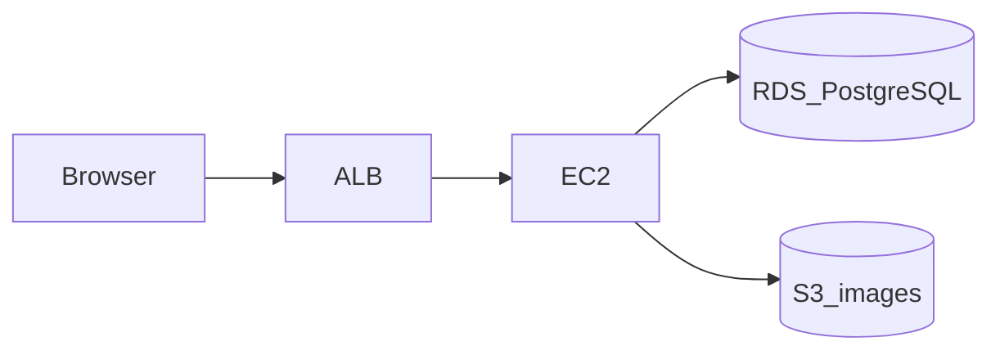

# インフラ構成

| 項目 | 内容 |
|---|---|
| 文書名 | インフラ構成 |
| 対象システム | 学習用SNS（X風のタイムラインアプリ） |
| 版 | 1.0 |
| 作成日 | 2026年10月30日 |
| 改訂日 | 2026年10月30日 |
| 作成者 | nsb |
| 関連資料 | 要件定義書、技術スタック、データベース設計 |
| 目的 | AWS に載せる場合の箱の並びを、先に図で固定する |

言葉の意味は「用語定義書」に従います。採用する技術の正は「技術スタック」です。

この資料は構成図です。AWS 上にサーバを構築するかは、まだ決めていません。決めたのは画像の保存先が S3 であることと、載せる場合は ALB、EC2、RDS を使うことです。Terraform の手順や、インスタンスの作成コマンドは、実施を決めてから別資料にします。

リージョンの目安は `ap-northeast-1`（東京）です。

---

## 1. 何を置くか

ブラウザの入口は ALB だけにする。画面のファイルと API は同じ EC2 に置く。PostgreSQL は RDS で、EC2 からだけ接続する。画像は S3 で、EC2 の IAM ロールからだけ読み書きする。

課題管理ボードの AWS 手順は、入口が EC2 の nginx 直結である。本システムは、その EC2 と RDS の前に ALB を置く。



EC2 の中は次のとおりである。Vite の開発サーバは EC2 では起動しない。

```text
ブラウザ
  └─ ALB（80）
       └─ EC2
            ├─ nginx（80）
            │    ├─ 画面のファイル    ビルド済みの React
            │    └─ /api/*           127.0.0.1:8080
            └─ Spring Boot（8080）
                 ├─ RDS（5432）      公開しない
                 └─ S3               公開読み取りにしない
```

| 役割 | 置き場所 | 目安 |
|---|---|---|
| 入口 | ALB | リスナーは HTTP 80。HTTPS は証明書を決めてから足す |
| 画面 | EC2 の nginx | 手元でビルドした静的ファイル |
| API | EC2 の Spring Boot | Java 21。ポート 8080 は EC2 の外へ開けない |
| 文章と関係 | RDS | PostgreSQL 16。公開アクセスはオフ |
| 画像 | S3 | 非公開。posts.image_key が指す |

開発中は ALB、EC2、RDS を使わない。画面は localhost の Vite、API は localhost の Spring Boot、PostgreSQL は Docker である。画像だけは、開発中も S3 を使う。

---

## 2. 通信の向き

| 通信 | 許可する相手 | 用途 |
|---|---|---|
| ブラウザ → ALB の 80 | 学習で使う範囲。公開の広さは構築時に決める | 画面と `/api` |
| ALB → EC2 の 80 | ALB のセキュリティグループだけ | nginx |
| ブラウザ → EC2 の 8080 | 許可しない | API は nginx 経由だけ |
| EC2 → RDS の 5432 | EC2 のセキュリティグループだけ | PostgreSQL。IP では開けない |
| EC2 → S3 | EC2 の IAM ロール | 画像の PUT と、期限付き URL の発行 |
| 開発用 PC → RDS の 5432 | 許可しない | RDS は VPC の中だけ |

SSH の 22 を開ける相手は、構築を決めたときに、作業する PC のアドレスだけにする。この資料では 22 を公開入口にしない。

S3 のブロックパブリックアクセスはオンにする。画面が画像を読む URL は、API が発行する期限付き URL である。ALB は画像のバイト列を中継しない。

---

## 3. 各サービスの役割

### 3.1 ALB

利用者のブラウザから見たホストは ALB である。パス `/` は画面、パス `/api` は同じ EC2 の nginx へ渡す。ターゲットグループの対象は EC2 の 80 番である。

ヘルスチェックは nginx が応答するパスとする。API の `/api/health` を ALB が見るかどうかは、構築時にどちらか一方へ固定する。

証明書が無い間は HTTP 80 とする。HTTPS を足すときは、この資料の版を上げてからリスナーを追加する。

### 3.2 EC2

1台に nginx と Spring Boot を置く。画面と API でサーバを分けない。

nginx は静的ファイルを返し、`/api` だけを `127.0.0.1:8080` へ渡す。Spring Boot は localhost だけを待ち受ける。

EC2 から S3 へは、インスタンスに付けた IAM ロールでアクセスする。アクセスキーを EC2 のファイルに置かない。

インスタンス型、台数、AMI は構築時に決める。現時点の前提は1台である。オートスケールはしない。

### 3.3 RDS

エンジンは PostgreSQL 16。表は「データベース設計」の5表である。開発中の Docker と同じ定義を使う。

公開アクセスはオフにする。セキュリティグループは、EC2 からの 5432 だけを許可する。データベース名、ユーザー名、パスワードは Git に入れない。

マルチ AZ とリードレプリカは、今回の前提に含めない。

### 3.4 S3

バケットは画像専用である。オブジェクトキーの基本は `posts/{postId}` とする。

EC2 のロールには、そのバケットの該当プレフィックスへの PUT と GET だけを許す。画面用の期限付き URL は GET 用である。

バケットを空にするライフサイクルや、別リージョンへの複製は、今回の前提に含めない。

---

## 4. 開発中との対応

| 層 | 開発中 | この構成図 |
|---|---|---|
| 入口 | ブラウザが Vite と API を直接開く | ALB |
| 画面 | Vite | EC2 の nginx |
| API | Spring Boot | EC2 の Spring Boot |
| PostgreSQL | Docker Compose | RDS |
| 画像 | S3 | S3 |

画面の API 呼び出しは、開発中も載せるときも、相対パス `/api` に揃える。開発中の Vite が `/api` を `http://localhost:8080` へ渡す。この形にしておかないと、EC2 に置いた画面がブラウザ自身の 8080 を呼んでしまう。課題管理ボードと同じ注意である。

---

## 5. この図に含めないもの

次は、構築を決めるときも初期の前提には入れない。必要になったら、この資料を改訂してから追加する。

- CloudFront
- WAF
- ElastiCache
- 複数台の EC2、オートスケール
- NAT ゲートウェイを必須とするプライベートサブネット構成。EC2 を ALB の配下に置き、S3 へは IAM ロールで到達する前提とする。VPC エンドポイントを足す場合は改訂する
- 監視、アラーム、運用ログの基盤
- 独自ドメインと HTTPS 証明書。未決定

---

## 6. 未決定であること

| 項目 | 状態 |
|---|---|
| S3 を画像の保存先にすること | 決定 |
| ALB、EC2、RDS の組み合わせ | 載せる場合の前提として決定 |
| AWS にサーバを実際に構築すること | 未決定 |
| インスタンス型、RDS のサイズ、バケット名 | 未決定 |
| HTTPS | 未決定 |
| Terraform で作るか、手動か | 未決定。課題管理ボードは Terraform である |

完成の定義（要件定義書第11章）は、開発中の環境で満たせばよい。この図のリソースが未作成であることは、不合格にしない。

---

## 7. 改訂履歴

| 版 | 日付 | 内容 |
|---|---|---|
| 1.0 | 2026年10月30日 | 初版。ALB、EC2、RDS、S3 の構成図。構築の実施は未決定と明記した |
