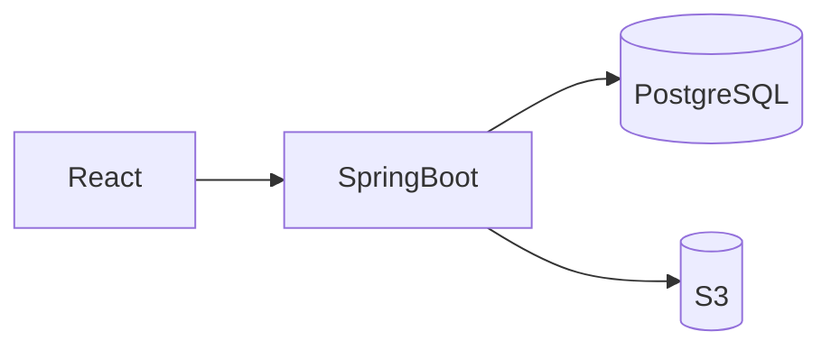

# データベース設計

| 項目 | 内容 |
|---|---|
| 文書名 | データベース設計 |
| 対象システム | 学習用SNS（X風のタイムラインアプリ） |
| 版 | 1.0 |
| 作成日 | 2026年10月30日 |
| 改訂日 | 2026年10月30日 |
| 作成者 | nsb |
| 関連資料 | 用語定義書、要件定義書、ER図、機能要件、技術スタック、インフラ構成 |
| 目的 | PostgreSQL の表の項目、型、制約を決める |

関係の図は「ER図」を正とします。使う技術は「技術スタック」を正とします。  
文章と関係の保存は PostgreSQL です。開発中は手元の Docker、AWS に載せる場合は RDS です。どちらも同じ表定義を使います。  
画像ファイルは PostgreSQL に入れません。

---

## 1. 保存方式の方針

| 項目 | 内容 | 今回しないこと |
|---|---|---|
| 文章と関係 | PostgreSQL の5表 | localStorage を主保存にすること |
| 画像 | S3。posts.image_key がオブジェクトキー | バイト列を posts に持つこと。公開バケット |
| ID | UUID | 画面に連番を出すこと |
| 件数 | SELECT の COUNT | いいね数などの保存列 |
| アクセス | Spring Boot から JDBC。SQL はブラウザから出さない | ORM |

---

## 2. 表一覧

| 表 | 意味 |
|---|---|
| users | ユーザー |
| posts | 投稿 |
| comments | コメント |
| likes | いいね |
| follows | フォロー |

列名は snake_case とする。API の JSON 名は実装時に camelCase にしてよい。意味の正はこの表である。

---

## 3. users

| 列 | 型 | NULL | 制約 | 説明 |
|---|---|---|---|---|
| id | uuid | 不可 | 主キー | ユーザーの識別子 |
| username | varchar(15) | 不可 | 一意（大文字小文字を区別しない） | `@` なし。4〜15文字。半角英字で始まり、続きは半角英数字または `_` |
| display_name | varchar(50) | 不可 | | 1〜50文字。重複可 |
| email | varchar(255) | 不可 | 一意（大文字小文字を区別しない） | ログインにも使う |
| password_hash | varchar(255) | 不可 | | パスワードのハッシュ。平文は不可 |
| created_at | timestamptz | 不可 | | 登録日時 |

ユーザー名とメールの一意は、大文字小文字を区別しない一意索引にする。実装例は PostgreSQL の `UNIQUE` 索引を `lower(username)`、`lower(email)` に付ける。

更新日時の列は持たない。プロフィール編集が対象外のためである。

---

## 4. posts

| 列 | 型 | NULL | 制約 | 説明 |
|---|---|---|---|---|
| id | uuid | 不可 | 主キー | 投稿の識別子 |
| user_id | uuid | 不可 | 外部キー → users.id | 投稿者 |
| body | varchar(280) | 不可 | 1〜280文字 | 本文 |
| image_key | text | 可 | | S3 のオブジェクトキー。画像が無いときは NULL |
| created_at | timestamptz | 不可 | | 投稿日時。ホームはこの降順、同じ時刻は id の降順 |

ホームの条件は、`user_id` がログイン中のユーザーであるか、`user_id` がログイン中ユーザーの followee であるかである。この条件用の列は posts に足さない。

画像の形式と5MBの検査は、INSERT の前に API が行う。形式の列は持たない。

---

## 5. comments

| 列 | 型 | NULL | 制約 | 説明 |
|---|---|---|---|---|
| id | uuid | 不可 | 主キー | コメントの識別子 |
| post_id | uuid | 不可 | 外部キー → posts.id | 対象の投稿 |
| user_id | uuid | 不可 | 外部キー → users.id | 書いたユーザー |
| body | varchar(280) | 不可 | 1〜280文字 | 本文 |
| created_at | timestamptz | 不可 | | コメント日時。一覧はこの昇順、同じ時刻は id の昇順 |

親コメントを指す列は持たない。

---

## 6. likes

| 列 | 型 | NULL | 制約 | 説明 |
|---|---|---|---|---|
| id | uuid | 不可 | 主キー | いいねの識別子 |
| post_id | uuid | 不可 | 外部キー → posts.id | 対象の投稿 |
| user_id | uuid | 不可 | 外部キー → users.id | いいねしたユーザー |
| created_at | timestamptz | 不可 | | 付けた日時 |

一意制約: `(post_id, user_id)`。

解除は、この行を DELETE する。解除フラグの列は持たない。

---

## 7. follows

| 列 | 型 | NULL | 制約 | 説明 |
|---|---|---|---|---|
| id | uuid | 不可 | 主キー | フォローの識別子 |
| follower_id | uuid | 不可 | 外部キー → users.id | フォローする側 |
| followee_id | uuid | 不可 | 外部キー → users.id | フォローされる側 |
| created_at | timestamptz | 不可 | | フォローした日時。一覧はこの降順 |

一意制約: `(follower_id, followee_id)`。  
検査制約: `follower_id <> followee_id`。

解除は、ログイン中のユーザーが follower_id である行を DELETE する。

相互フォローは、向きの違う2行である。それを示す列は持たない。

---

## 8. 参照整合性

今回の画面に、ユーザー削除と投稿削除は無い。外部キーは、存在しない親を指せないようにする。

| 親 | 子 | 考え方 |
|---|---|---|
| users | posts | 投稿は投稿者に従属する |
| users | comments | コメントは書いた人に従属する |
| users | likes | いいねは付けた人に従属する |
| users | follows.follower_id | フォローはフォローする人に従属する |
| users | follows.followee_id | フォローはフォローされる人に従属する |
| posts | comments | コメントは投稿に従属する |
| posts | likes | いいねは投稿に従属する |

画面から行を消してよいのは、いいね解除とフォロー解除だけである。

ユーザーや投稿を将来削除する場合は、この資料を改訂し、子行の扱いを決めてからにする。現時点では、親の削除はデータベースの外部キーで拒む（`ON DELETE RESTRICT`）。

---

## 9. 索引の目安

主キーと、第3章から第7章の一意制約に加えて、読み取りのために次を置く。

| 索引 | 用途 |
|---|---|
| posts(user_id, created_at) | プロフィールの投稿一覧。ホームの絞り込み |
| comments(post_id, created_at) | コメント一覧と件数 |
| likes(post_id) | いいね数 |
| follows(follower_id, created_at) | フォロー中一覧、ホームの followee 解決 |
| follows(followee_id, created_at) | フォロワー一覧とフォロワー数 |

ユーザー検索は、username と display_name の部分一致である。学習用の件数では、大文字小文字を区別しない部分一致の SQL で足りる。全文検索の拡張は今回入れない。

---

## 10. 改訂履歴

| 版 | 日付 | 内容 |
|---|---|---|
| 1.0 | 2026年10月30日 | 初版。5表。画像キー。フォローの一意と自己フォロー禁止 |
