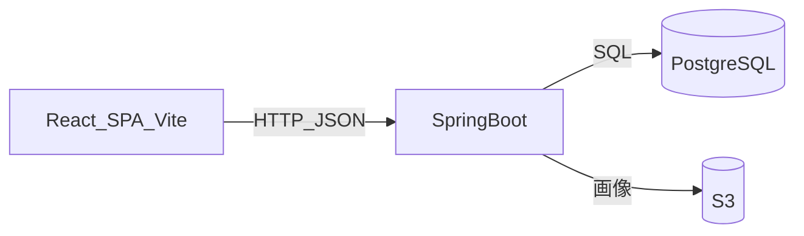

# 技術スタック

| 項目 | 内容 |
|---|---|
| 文書名 | 技術スタック |
| 対象システム | 学習用SNS（X風のタイムラインアプリ） |
| 版 | 1.1 |
| 作成日 | 2026年10月30日 |
| 改訂日 | 2026年10月30日 |
| 作成者 | nsb |
| 関連資料 | 用語定義書、要件定義書、データベース設計、インフラ構成 |
| 目的 | 採用する技術と、採用しない技術を決める |

何を作るかは「要件定義書」と「機能要件」を正とします。保存の形は「データベース設計」を正とします。  
この資料は、課題管理ボード（デスクトップの「アプリケーション」）と同じ層の分け方に揃えています。違いは、ログインがあること、画像を S3 に置くこと、AWS に載せる場合の入口を ALB にすることです。

ライブラリと実行環境の版は、課題管理ボードの「技術スタック」第2章で固定した版と同じものを使う。実装時に別の版へ上げない。

---

## 1. 全体の組み合わせ

画面は React、サーバは Java と Spring Boot、文章と関係の保存は PostgreSQL、画像は S3 とする。画面は JavaScript（JSX）、API は Java で書く。

React は画面（ブラウザ側）で使う。API や SQL は React では扱わない。Next.js は使わないので、画面は Vite で単体の SPA として動かす。

| 層 | 採用するもの | 役割 |
|---|---|---|
| 画面 | React（Vite） | ログイン、ホーム、詳細、検索、プロフィール |
| API | Spring Boot（Java 21） | 画面からの要求を受け、PostgreSQL と S3 を読み書きする |
| 文章の保存 | PostgreSQL | users、posts、comments、likes、follows |
| 画像 | Amazon S3 | 投稿画像1枚。キーだけを posts に残す |
| 言語 | 画面は JavaScript（JSX）。API は Java | 層ごとに使う言語を分ける |
| パッケージ | 画面は npm。API は Maven | 依存関係の導入 |

開発中の置き場所は次のとおりである。AWS の箱は「インフラ構成」を正とし、構築の実施は未決定である。

| 場所 | 開発中 | AWS に載せる場合 |
|---|---|---|
| 画面 | Vite（`http://localhost:5173`） | EC2 の nginx がビルド済みファイルを配信する |
| API | Spring Boot（`http://localhost:8080`） | 同じ EC2 の 127.0.0.1:8080。外からは ALB 経由 |
| PostgreSQL | Docker Compose | RDS |
| 画像 | S3 | 同じ S3 |

---

## 2. 採用する版

課題管理ボードで実装時に固定した版を、このアプリでもそのまま使う。正は課題管理ボードの `frontend/package-lock.json`、`backend/pom.xml`、Maven Wrapper、`docker-compose.yml` の各行である。

| 技術 | 版 | 宣言と置き場所 |
|---|---|---|
| React | 19.3.0 | `package.json` は `react` `^19.1.1`。入る版は 19.3.0 |
| react-dom | 19.3.0 | `react-dom` `^19.1.1`。入る版は 19.3.0 |
| Vite | 7.3.6 | `vite` `^7.1.5`。入る版は 7.3.6 |
| @vitejs/plugin-react | 5.2.0 | `@vitejs/plugin-react` `^5.0.2`。入る版は 5.2.0 |
| Node.js | 20.19.0 以上、または 22.12.0 以上 | Vite 7 が要求する実行環境 |
| Java | 21 | `pom.xml` の `java.version`。JDK は Microsoft Build of OpenJDK 21.0.12 |
| Spring Boot | 4.1.1 | `pom.xml` の parent |
| Maven | 3.9.16 | Maven Wrapper 3.3.4 が取得する配布物 |
| PostgreSQL | 16 | 開発中のイメージは `postgres:16-alpine`。RDS に載せる場合も 16 |
| PostgreSQL JDBC | Spring Boot 4.1.1 が管理する版 | 独自に版を指定しない |

`package.json` の `^` は課題管理ボードと同じ範囲にする。lock ファイルを作るときは、上表の版で固定する。範囲の中のより新しい版へ上げて揃えない。

---

## 3. 開発中の動かし方（予定）

実装に入ってからの手順書は、まだ作らない。課題管理ボードのデプロイガイドと同じ段取りにする予定である。

1. JDK 21（21.0.12）、Docker Desktop、Node.js（20.19.0 以上、または 22.12.0 以上）が入っていることを確認する
2. Docker Compose で PostgreSQL 16（`postgres:16-alpine`）を起動する
3. Maven Wrapper 3.3.4 から Spring Boot 4.1.1 の API を起動する
4. `GET /api/health` で API とデータベースの接続を確認する
5. Vite で画面を起動し、Chrome または Edge で登録からフォローまでを確認する

画像の確認には、到達できる S3 バケットが要る。バケット名と認証情報は Git に入れない。

ログインは必要である。クラウドへサーバを載せる作業は、この動かし方には含めない。

---

## 4. 採用するもの

| 採用するもの | 層 | 理由 |
|---|---|---|
| React 19.3.0 | 画面 | 課題管理ボードと同じ版。画面をコンポーネントに分ける |
| Vite 7.3.6 | 画面 | Next.js を使わない React の開発サーバ。プラグインは `@vitejs/plugin-react` 5.2.0 |
| CSS | 画面 | 見た目。追加の UI ライブラリは使わない |
| `fetch` | 画面 | ブラウザ標準で API を呼ぶ |
| Java 21 | API | Spring Boot を動かす言語。JDK は Microsoft Build of OpenJDK 21.0.12 |
| Spring Boot 4.1.1 | API | JSON の REST API |
| Spring Security | API | パスワードのハッシュと、ログイン状態の確認。版は Spring Boot 4.1.1 が管理する。未ログインの書き込みを拒む |
| サーバセッション | API | ログイン状態は HTTP セッションで持つ。トークン方式にはしない |
| Maven 3.9.16（Wrapper 3.3.4） | API | PC に Maven を入れなくても `mvnw.cmd` でビルドできる |
| PostgreSQL JDBC | API | SQL を画面から隠さず書く。版は Spring Boot 4.1.1 が管理する |
| PostgreSQL 16 | 保存 | 5表。開発中は `postgres:16-alpine`。AWS の場合は RDS の PostgreSQL 16 |
| Docker Compose | 保存 | 開発中の PostgreSQL |
| Amazon S3 | 画像 | 保存先として決めた。公開読み取りにはしない |
| 期限付き URL | 画像 | API が発行し、画面の `img` がそれを読む |
| npm | 画面 | React / Vite のパッケージ管理 |
| Chrome または Edge | 実行 | 提出と説明で使うブラウザ |

パスワードハッシュは BCrypt とする。平文は保存しない。

開発中、Vite の画面から API を呼ぶときは CORS で必要なメソッドを許可する。AWS に載せたあとは、画面と API を同じホストの ALB 経由にし、画面の API の基点は相対パス `/api` とする。課題管理ボードの `API_BASE` を空にする方針と同じである。

---

## 5. 実行環境

| 項目 | 内容 |
|---|---|
| OS | 開発と説明は Windows のパソコン |
| ブラウザ | Chrome または Edge |
| ランタイム | API は JDK 21（Microsoft Build of OpenJDK 21.0.12）。画面の開発サーバは Node.js 20.19.0 以上、または 22.12.0 以上 |
| データベース | 開発中は Docker の PostgreSQL 16（`postgres:16-alpine`）。AWS の場合は RDS の PostgreSQL 16 |
| 画像 | S3。リージョンの目安は `ap-northeast-1` |
| パッケージ管理 | API は Maven Wrapper 3.3.4（Maven 3.9.16）。画面は npm |
| 画面の開発サーバ | Vite 7.3.6（`http://localhost:5173`） |
| API サーバ | Spring Boot 4.1.1（`http://localhost:8080`） |
| 動作確認 | `GET /api/health` で API と PostgreSQL を確認する。形は実装時に固定する |
| AWS | ALB、EC2、RDS、S3。構築するかは未決定。図はインフラ構成 |

Safari や Firefox での動作保証、スマートフォン専用アプリは対象外である。

---

## 6. 画面まわりの技術（React）

| 項目 | 内容 |
|---|---|
| ライブラリ | React 19.3.0、react-dom 19.3.0。関数コンポーネントと Hooks（`useState` / `useEffect`） |
| 開発・バンドル | Vite 7.3.6、`@vitejs/plugin-react` 5.2.0 |
| ルーティング | 画面IDごとにパスを分ける。ライブラリは実装時に、標準の履歴 API で足りるかを見て決める。Next.js のルータは使わない |
| 状態 | ログイン中のユーザーと、表示中の一覧はコンポーネントの state で持つ。専用の状態ライブラリは使わない |
| 見た目 | CSS。Tailwind やコンポーネントライブラリは使わない |
| 画像投稿 | `input type="file"`。1枚だけ |
| 認証 | セッション Cookie。画面はログイン失敗を API の応答で判断する |

画面の部品と動きの正は「画面設計書」とする。

---

## 7. API まわりの技術（Spring Boot）

| 項目 | 内容 |
|---|---|
| サーバ | Spring Boot 4.1.1 on Java 21 |
| ビルド | Maven Wrapper 3.3.4（Maven 3.9.16） |
| 形式 | REST。JSON。画像の送信は multipart |
| 認証 | Spring Security。フォームのログインに相当する API と、セッション |
| 認可 | 投稿、コメント、いいね、フォロー、検索はログイン必須。投稿者の ID はセッションから取る |
| DB 接続 | PostgreSQL の JDBC。SQL は後から `schema.sql` に書く |
| S3 | AWS SDK で PUT し、表示時に期限付きの GET URL を JSON に含める |
| 設定 | 接続先、バケット名、資格情報は環境変数。Git に入れない |
| ポート | 開発中は 8080 |

API は画面と、PostgreSQL および S3 の間に置く。SQL も S3 もブラウザから直接は呼ばない。

エンドポイントの一覧は、実装に入るときに別資料へ起こす。この資料では技術の選択までを決める。

---

## 8. 保存まわりの技術

### 8.1 PostgreSQL

| 項目 | 内容 |
|---|---|
| DBMS | PostgreSQL 16（開発中のイメージは `postgres:16-alpine`） |
| 開発中 | Docker Compose。クラウドの DB は使わない |
| AWS に載せる場合 | RDS。公開アクセスはオフ。EC2 からだけ接続する |
| 表 | 5表。項目と制約は「データベース設計」 |
| アクセス | JDBC |
| ID | UUID |

### 8.2 S3

| 項目 | 内容 |
|---|---|
| 用途 | 投稿画像。1投稿につき0または1オブジェクト |
| 公開 | ブロックする。バケットポリシーで公開読み取りを許さない |
| キー | posts.image_key。オブジェクトキーの形は実装時に `posts/{postId}` を基本とする |
| 読み出し | API が期限付き URL を発行する。期限の分数は実装時に決める |
| 失敗 | 画像の PUT に失敗したら posts の行も残さない |

---

## 9. 採用しないもの

| 採用しないもの | 理由 |
|---|---|
| Next.js | 課題管理ボードと同じく対象外。画面は Vite の React SPA |
| TypeScript | 画面は JavaScript で揃える |
| JPA / Hibernate などの ORM | SQL の形が見えにくくなる。JDBC で足りる |
| Redux などの状態ライブラリ | 今回の画面数に対して準備が重い |
| Tailwind などの CSS フレームワーク | プレーンな CSS で足りる |
| 画像のバイト列を PostgreSQL に保存 | ファイルは S3 |
| S3 の公開 URL | 画像を誰でも読める状態にしない |
| CloudFront | 学習の第一段階の構成に含めない |
| localStorage（主保存） | 複数人の文章は PostgreSQL に残す |
| トークンを画面の localStorage に置く認証 | セッション Cookie にする |
| Node.js + Express（API） | API は Spring Boot |

---

## 10. 改訂履歴

| 版 | 日付 | 内容 |
|---|---|---|
| 1.0 | 2026年10月30日 | 初版。課題管理ボードの層に、セッション認証と S3 を加えた |
| 1.1 | 2026年10月30日 | React、Vite、Node.js、Java、Spring Boot、Maven、PostgreSQL の版を、課題管理ボードと同じ指定にした |
