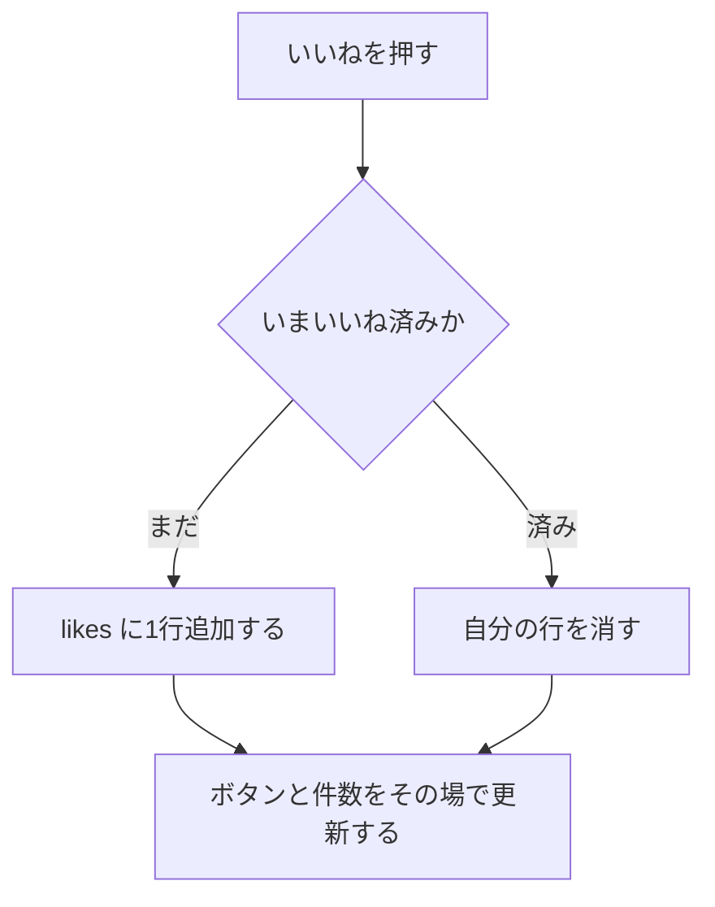

# 機能定義：いいね

| 項目 | 内容 |
|---|---|
| 文書名 | 機能定義（いいね） |
| 対象システム | 学習用SNS（X風のタイムラインアプリ） |
| 版 | 1.0 |
| 作成日 | 2026年10月30日 |
| 作成者 | nsb |
| 関連資料 | 用語定義書、要件定義書、機能要件、画面設計書、データベース設計 |
| 目的 | 投稿へのいいねと、いいね数・コメント数の出し方を決める |
| 機能No. | L-1、L-2、L-3 |

言葉の意味は「用語定義書」に従います。

---

## 1. 目的

ログイン中のユーザーが投稿に反応し、第三者の反応も含めた件数を、ホームと詳細で同じ意味で見せる。

| 項目 | 内容 |
|---|---|
| 対象 | ログイン中のユーザー。対象は投稿だけ |
| 中心の操作 | 投稿カードのいいねボタン |
| 保存 | 追加は likes に1行。解除はその行の削除。件数の列は持たない |

---

## 2. 範囲

### 2.1 今回作る

| No. | 内容 |
|---|---|
| L-1 | まだいいねしていない投稿に、自分のいいねを1件付ける |
| L-2 | 自分のいいねを解除する |
| L-3 | いいね数とコメント数を表示する |

### 2.2 今回作らない

- コメントへのいいね
- いいねした人の一覧
- いいねされた通知
- 件数の保存用カウンタ
- インプレッション数

---

## 3. 規則

| 項目 | 約束 |
|---|---|
| 対象 | 存在する投稿1件 |
| 人数 | 1ユーザーにつき1投稿へ1行。一意は `(post_id, user_id)` |
| 操作 | 未いいねのボタンは追加。いいね済みのボタンは解除。画面遷移しない |
| 解除 | 自分の行だけを消す。他のユーザーの行は残る |
| 見た目 | 未いいねといいね済みを区別できる |
| いいね数 | その post_id の likes の行数。0も表示する |
| コメント数 | その post_id の comments の行数。0も表示する |
| 自分の状態 | その post_id とログイン中の user_id の likes が1行あるか |
| 反映 | ホーム、投稿詳細、プロフィールのカードで、同じ投稿なら同じ件数の意味になる |

フォローしていない人の投稿でも、詳細またはプロフィールを開いていればいいねできる。その投稿は、フォローするまでホームには出ない。

---

## 4. 操作フロー

### 4.1 UF-L1 いいねを付ける、外す

| 項目 | 内容 |
|---|---|
| 種類 | 操作フロー |
| 対応する機能 | L-1、L-2、L-3 |

失敗したときは、押す前の表示に戻し、失敗を伝える。

---

## 5. 例外

| 状況 | 扱い |
|---|---|
| すでに行があるのに追加しようとした | 2行目は作らない。画面はいいね済みのまま |
| 行が無いのに解除しようとした | 失敗にせず、未いいねの表示にする |
| 投稿が存在しない | 追加しない |
| 未ログイン | SCR-01 へ送る |
| API に失敗 | 表示を戻し、できなかったことを伝える |

---

## 6. 画面とデータ

| 機能 | 画面 | データ |
|---|---|---|
| L-1 | SCR-03、SCR-04。プロフィールのカードでも同じボタンを出す | likes に INSERT |
| L-2 | 同上 | 自分の likes を DELETE |
| L-3 | SCR-03、SCR-04、SCR-06 | COUNT。列としては保存しない |

---

## 7. 完成とみなす条件

1. いいねを付けると件数が1増え、ボタンがいいね済みになる
2. 解除すると件数が1減り、他のユーザーのいいねは残る
3. 同じユーザーが同じ投稿に2件のいいねを持てない
4. 別のユーザーのいいねが、自分の画面の件数に含まれる
5. 0件の投稿でも件数が分かる
6. コメントにいいねボタンが無い
7. インプレッション数が無い

---

## 8. 改訂履歴

| 版 | 日付 | 内容 |
|---|---|---|
| 1.0 | 2026年10月30日 | 初版 |
