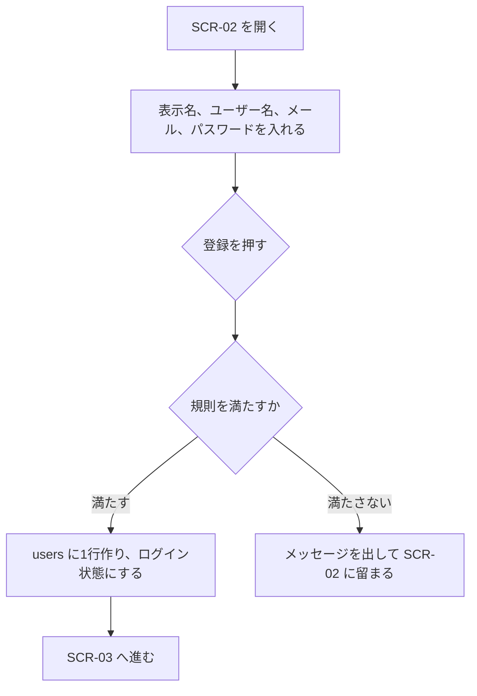
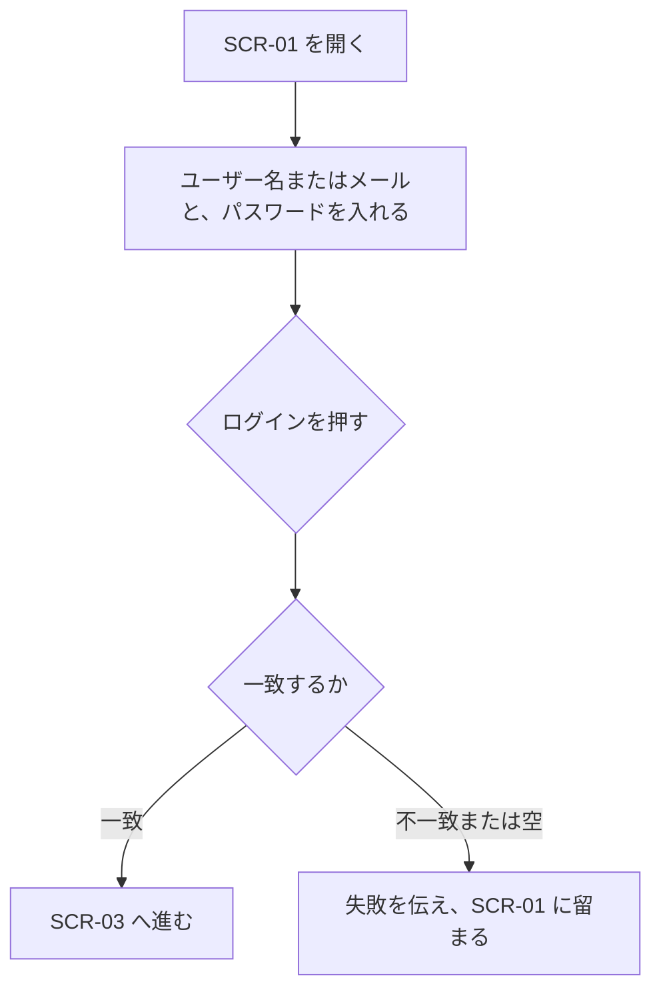
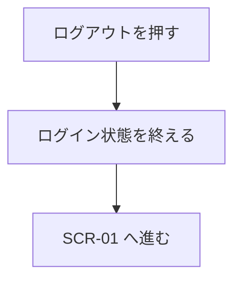

# 機能定義：アカウント

| 項目 | 内容 |
|---|---|
| 文書名 | 機能定義（アカウント） |
| 対象システム | 学習用SNS（X風のタイムラインアプリ） |
| 版 | 1.0 |
| 作成日 | 2026年10月30日 |
| 作成者 | nsb |
| 関連資料 | 用語定義書、要件定義書、機能要件、画面設計書、データベース設計 |
| 目的 | 登録、ログイン、ログアウトの範囲・流れ・完成条件を決める |
| 機能No. | A-1、A-2、A-3 |

言葉の意味は「用語定義書」に従います。番号の正は「機能要件」です。

---

## 1. 目的

複数人が、自分の投稿といいねとフォローを区別できるように、アカウントを持つ。

| 項目 | 内容 |
|---|---|
| 対象 | 未登録の人の登録。登録済みの人のログインとログアウト |
| 中心の操作 | フォームの送信と、共通ヘッダーのログアウト |
| 保存 | users に1行。パスワードはハッシュだけを残す |

---

## 2. 範囲

### 2.1 今回作る

| No. | 内容 |
|---|---|
| A-1 | 表示名、ユーザー名、メールアドレス、パスワードで登録する。成功するとログイン状態でホームへ進む |
| A-2 | ユーザー名またはメールアドレスと、パスワードでログインする |
| A-3 | ログアウトし、ログイン画面へ戻る |

### 2.2 今回作らない

- パスワード再設定、メール到達の確認
- ユーザー名や表示名の変更、アカウント削除
- 二要素認証、ソーシャルログイン
- プロフィール文、アイコン画像

---

## 3. 規則

| 項目 | 約束 |
|---|---|
| 表示名 | 必須。1〜50文字。前後の空白は除く。除いたあと空なら不可。重複可 |
| ユーザー名 | 必須。4〜15文字。半角英字で始まり、続きは半角英数字または `_`。`@` は保存しない |
| ユーザー名の一意 | 大文字小文字を区別しない。`Ada` があるとき `ada` は登録できない |
| メールアドレス | 必須。一意。大文字小文字は区別しない。`@` を1つ含む形であること |
| パスワード | 必須。8文字以上。最大は実装時に128文字とする。ハッシュで保存する |
| ログインID | ユーザー名またはメールアドレス。どちらか一方の入力欄 |
| すでにログイン中 | SCR-01 と SCR-02 を開いたら SCR-03 へ進む |

画面に出すユーザー名は、保存値の前に `@` を付ける。

---

## 4. 操作フロー

### 4.1 UF-A1 登録する

| 項目 | 内容 |
|---|---|
| 種類 | 操作フロー |
| 対応する機能 | A-1 |

### 4.2 UF-A2 ログインする

| 項目 | 内容 |
|---|---|
| 種類 | 操作フロー |
| 対応する機能 | A-2 |

パスワードが違うことと、ユーザーがいないことを、別の文にはしない。

### 4.3 UF-A3 ログアウトする

| 項目 | 内容 |
|---|---|
| 種類 | 操作フロー |
| 対応する機能 | A-3 |

確認ダイアログは出さない。

---

## 5. 例外

| 状況 | 扱い |
|---|---|
| 必須項目が空 | 保存しない。不足を伝える |
| ユーザー名の文字種または長さが範囲外 | 登録しない。規則を伝える |
| ユーザー名が重複 | 登録しない。「このユーザー名は使われています。」 |
| メールアドレスが重複 | 登録しない。「このメールアドレスは使われています。」 |
| メールアドレスの形が不正 | 登録しない |
| パスワードが8文字未満 | 登録しない |
| ログイン不一致 | 「ユーザー名またはパスワードが違います。」の趣旨。どちらが違いかは分けない |
| 未ログインで SCR-03 以降を開く | SCR-01 へ送る |

---

## 6. 画面とデータ

| 機能 | 画面 | データ |
|---|---|---|
| A-1 | SCR-02 | users に INSERT |
| A-2 | SCR-01 | users を照合する。行は増えない |
| A-3 | 共通ヘッダー | ログイン状態だけを終える。行は消さない |

---

## 7. 完成とみなす条件

1. 規則を満たす登録のあと、ホームに入れる
2. 同じユーザー名の大文字違いを、2人目は登録できない
3. ユーザー名でもメールアドレスでもログインできる
4. 誤ったパスワードでは入れず、正否の内訳は出ない
5. ログアウトのあと、投稿やフォローの操作はできない
6. パスワードの平文がデータベースに残らない

---

## 8. 改訂履歴

| 版 | 日付 | 内容 |
|---|---|---|
| 1.0 | 2026年10月30日 | 初版 |
