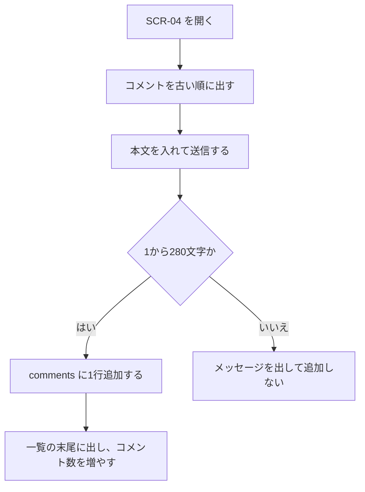

# 機能定義：コメント

| 項目 | 内容 |
|---|---|
| 文書名 | 機能定義（コメント） |
| 対象システム | 学習用SNS（X風のタイムラインアプリ） |
| 版 | 1.0 |
| 作成日 | 2026年10月30日 |
| 作成者 | nsb |
| 関連資料 | 用語定義書、要件定義書、機能要件、画面設計書、データベース設計 |
| 目的 | 投稿に対する1段階のコメントの範囲・流れ・完成条件を決める |
| 機能No. | C-1、C-2 |

言葉の意味は「用語定義書」に従います。コメント数の出し方は「機能定義/いいね」の L-3 と揃えます。

---

## 1. 目的

ログイン中のユーザーが、投稿に文章で反応する。第三者のコメントも、同じ一覧と件数に含まれる。

| 項目 | 内容 |
|---|---|
| 対象 | ログイン中のユーザー。対象の投稿は、フォロー関係を問わず詳細を開ける投稿 |
| 中心の操作 | 投稿詳細のコメント入力と一覧 |
| 保存 | comments に1行 |

---

## 2. 範囲

### 2.1 今回作る

| No. | 内容 |
|---|---|
| C-1 | 投稿に本文のコメントを1件追加する |
| C-2 | その投稿のコメントを古い順に表示する |

### 2.2 今回作らない

- コメントへの返信
- コメントへの画像
- コメントへのいいね
- コメントの編集、削除
- コメントしたことを相手に知らせる通知

---

## 3. 規則

| 項目 | 約束 |
|---|---|
| 本文 | 必須。前後の空白を除いて1〜280文字。改行は保存し、表示でも維持する |
| 対象 | 存在する posts の1件。コメントIDを親にする列は持たない |
| 投稿者 | ログイン中のユーザー。クライアントが送ったユーザーIDは採用しない |
| 並び | `created_at` の古い順。同じ時刻のときは id の昇順 |
| 表示 | 表示名、ユーザー名、日時、本文 |
| 0件 | 「まだコメントがありません。」の趣旨。入力欄は残す |
| 件数 | 追加に成功したあと、投稿カードのコメント数も1増える |

フォローしていない人の投稿詳細でも、ログインしていればコメントできる。

---

## 4. 操作フロー

### 4.1 UF-C1 コメントする

| 項目 | 内容 |
|---|---|
| 種類 | 操作フロー |
| 対応する機能 | C-1、C-2 |

---

## 5. 例外

| 状況 | 扱い |
|---|---|
| 本文が空 | 追加しない。本文が必要であることを伝える |
| 281文字以上 | 追加しない。280文字以下であることを伝える |
| 投稿が存在しない | 追加しない。見つからない旨を出す |
| 未ログイン | SCR-01 へ送る |
| API に失敗 | 追加できなかったことを伝える。一覧は成功した行だけ |

---

## 6. 画面とデータ

| 機能 | 画面 | データ |
|---|---|---|
| C-1 | SCR-04 | comments に INSERT |
| C-2 | SCR-04 | その post_id の comments を created_at 昇順で読む |

---

## 7. 完成とみなす条件

1. 投稿詳細でコメントを追加でき、一覧の末尾に出る
2. 別のユーザーのコメントも同じ一覧に出る
3. 並びは古い順である
4. 空の本文では追加されない
5. コメントに返信欄といいねボタンが無い
6. 追加後のコメント数が、一覧の件数と一致する

---

## 8. 改訂履歴

| 版 | 日付 | 内容 |
|---|---|---|
| 1.0 | 2026年10月30日 | 初版 |
