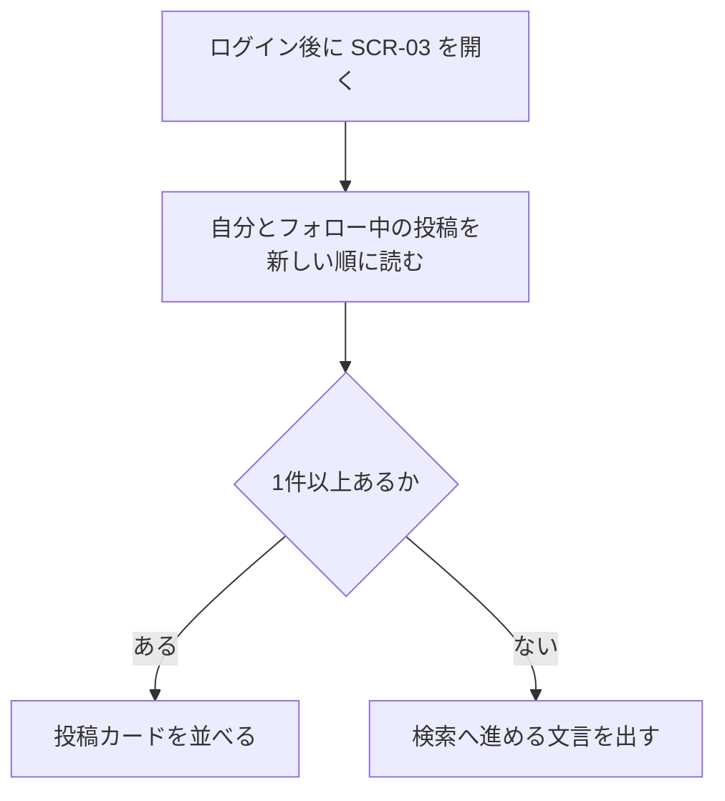
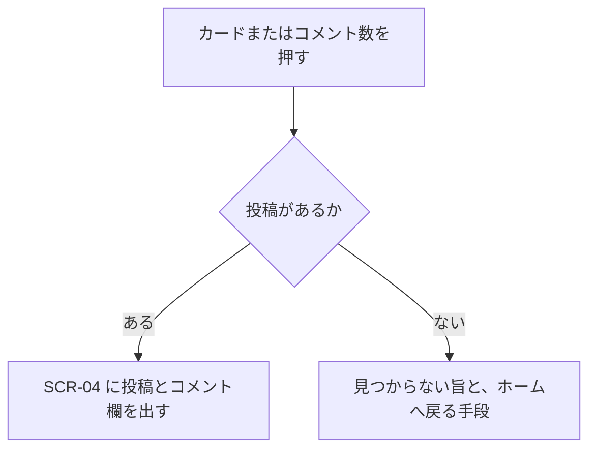

# 機能定義：タイムライン

| 項目 | 内容 |
|---|---|
| 文書名 | 機能定義（タイムライン） |
| 対象システム | 学習用SNS（X風のタイムラインアプリ） |
| 版 | 1.0 |
| 作成日 | 2026年10月30日 |
| 作成者 | nsb |
| 関連資料 | 用語定義書、要件定義書、機能要件、画面設計書、データベース設計、機能定義/フォロー |
| 目的 | ホームと投稿詳細に、どの投稿をどの順で出すかを決める |
| 機能No. | T-1、T-2 |

言葉の意味は「用語定義書」に従います。フォローの作り方は「機能定義/フォロー」を正とします。

---

## 1. 目的

ログイン後のメイン画面で、自分と、自分がフォローしている人の投稿を新しい順に読む。1件を開くとコメント欄まで進める。

| 項目 | 内容 |
|---|---|
| 対象 | ログイン中のユーザー |
| 中心の操作 | ホームの一覧と、投稿カードから詳細へ進む |
| 保存 | この機能だけでは行を作らない。posts、follows、likes、comments を読む |

---

## 2. 範囲

### 2.1 今回作る

| No. | 内容 |
|---|---|
| T-1 | ホームを表示する |
| T-2 | 投稿詳細を表示する |

### 2.2 今回作らない

- 全ユーザーの投稿を混ぜた一覧
- おすすめ、ランキング
- インプレッション数
- 無限スクロールの性能要件。学習用の件数を一度に出してよい
- 投稿の編集、削除

---

## 3. 規則

### 3.1 ホームに出す投稿

次のどちらかを満たす投稿を出す。

1. 投稿者の user_id が、ログイン中のユーザーである
2. 投稿者の user_id が、ログイン中のユーザーの followee である

フォローしていない人の投稿は、ホームに出さない。自分をフォローしていなくても、自分の投稿はホームに出る。自分自身への follows 行は作らない。

フォローした時点より前の投稿も、条件を満たせばホームに出る。フォローを外したあとは、相手の投稿はホームから外れる。相手の posts 行は残る。

### 3.2 順

`created_at` の新しい順。同じ時刻のときは id の降順で一意に決める。

### 3.3 カードに出すもの

表示名、ユーザー名、投稿日時、本文、画像があるときだけ画像、いいねの状態と件数、コメント数。

日時の表示が相対表記か絶対表記かは、画面設計書の範囲で実装時に揃えてよい。データ上の正は `created_at` である。

### 3.4 投稿詳細

ログイン中であれば、フォローしていない人の投稿でも詳細を開ける。入口は、ホームのカード、プロフィールのカード、詳細のURLである。

存在しない id を開いたときは、本文の代わりに見つからないことを伝え、ホームへ戻る手段を残す。

### 3.5 空のホーム

自分の投稿が無く、フォロー中の投稿も無いときは、カードを出さず、ユーザー検索へ進める文言を出す。投稿フォームは残す。

自分が投稿済みで、誰もフォローしていないときは、自分の投稿だけを出す。

---

## 4. 操作フロー

### 4.1 UF-T1 ホームを開く

| 項目 | 内容 |
|---|---|
| 種類 | 操作フロー |
| 対応する機能 | T-1 |

### 4.2 UF-T2 詳細を開く

| 項目 | 内容 |
|---|---|
| 種類 | 操作フロー |
| 対応する機能 | T-2 |

いいねボタンを押したときは、画面を変えず、いいねの定義に従ってその場を更新する。

---

## 5. 例外

| 状況 | 扱い |
|---|---|
| フォロー外の投稿 | ホームに出さない。プロフィールと詳細では読める |
| 投稿0件 | 空の文言と、検索への導線。フォームは残す |
| 投稿IDが無い | 見つからない旨。ホームへ戻れる |
| API に繋がらない | 接続を確認する旨 |
| 未ログイン | SCR-01 へ送る |

---

## 6. 画面とデータ

| 機能 | 画面 | データの読み方 |
|---|---|---|
| T-1 | SCR-03 | posts のうち、user_id が自分、または follows.followee_id が自分のフォロー先 |
| T-2 | SCR-04 | posts の1行。コメントはコメント定義、件数はいいね定義 |

---

## 7. 完成とみなす条件

1. フォローした人の投稿がホームに出る
2. フォローしていない人の投稿はホームに出ない
3. 自分の投稿は、誰もフォローしていなくてもホームに出る
4. 並びは新しい順である
5. カードから詳細へ進める
6. インプレッションの表示が無い
7. 投稿が無いホームでは、検索へ進める文言が出る

---

## 8. 改訂履歴

| 版 | 日付 | 内容 |
|---|---|---|
| 1.0 | 2026年10月30日 | 初版。ホームは全体タイムラインではなく、自分とフォロー中だけにした |
