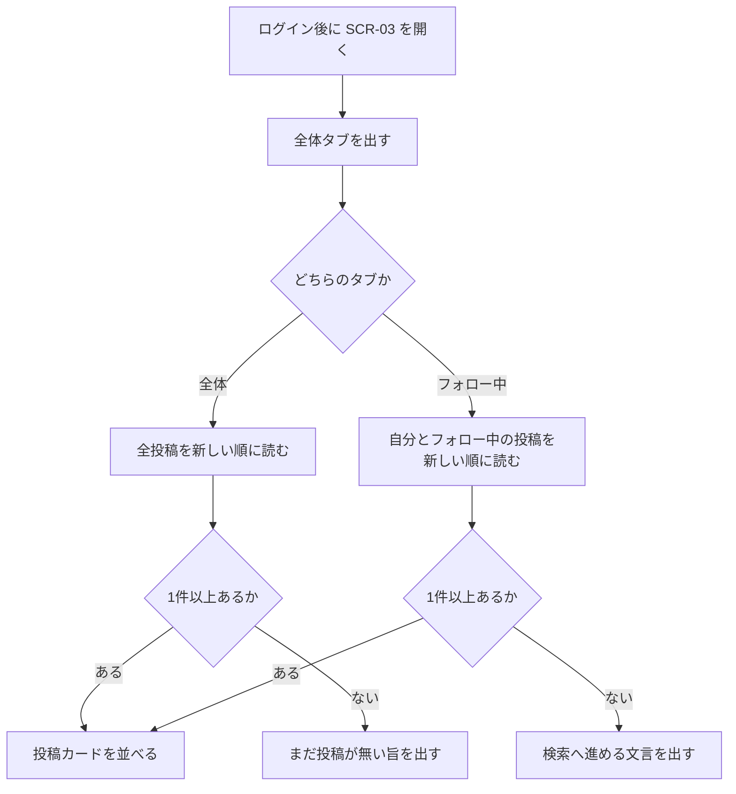
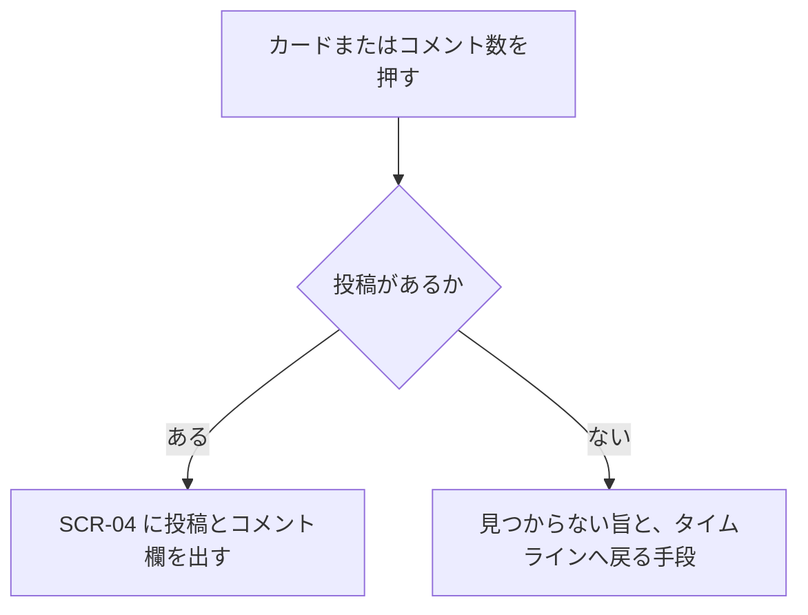

# 機能定義：タイムライン

| 項目 | 内容 |
|---|---|
| 文書名 | 機能定義（タイムライン） |
| 対象システム | 学習用SNS（X風のタイムラインアプリ） |
| 版 | 1.1 |
| 作成日 | 2026年10月30日 |
| 改訂日 | 2026年10月30日 |
| 作成者 | nsb |
| 関連資料 | 用語定義書、要件定義書、機能要件、画面設計書、データベース設計、機能定義/フォロー |
| 目的 | 全体タブ、フォロー中タブ、投稿詳細に、どの投稿をどの順で出すかを決める |
| 機能No. | T-1、T-2、T-3 |

言葉の意味は「用語定義書」に従います。フォローの作り方は「機能定義/フォロー」を正とします。

---

## 1. 目的

ログイン後のメイン画面で、全体とフォロー中をタブで切り替えて投稿を新しい順に読む。1件を開くとコメント欄まで進める。

| 項目 | 内容 |
|---|---|
| 対象 | ログイン中のユーザー |
| 中心の操作 | SCR-03 のタブと、投稿カードから詳細へ進む |
| 保存 | この機能だけでは行を作らない。posts、follows、likes、comments、users のアイコンを読む |

---

## 2. 範囲

### 2.1 今回作る

| No. | 内容 |
|---|---|
| T-1 | 全体タブを表示する |
| T-2 | フォロー中タブを表示する |
| T-3 | 投稿詳細を表示する |

### 2.2 今回作らない

- おすすめ順、ランキング
- インプレッション数
- 無限スクロールの性能要件。学習用の件数を一度に出してよい
- タブごとの別画面。切り替えは SCR-03 の中で行う

---

## 3. 規則

### 3.1 全体タブ

全ユーザーの posts を出す。フォローしているかどうかでは絞らない。

開いた直後、およびアプリ名を押して SCR-03 に戻ったときのタブは全体である。

### 3.2 フォロー中タブ

次のどちらかを満たす投稿を出す。

1. 投稿者の user_id が、ログイン中のユーザーである
2. 投稿者の user_id が、ログイン中のユーザーの followee である

フォローしていない人の投稿は、このタブに出さない。自分をフォローしていなくても、自分の投稿はこのタブに出る。自分自身への follows 行は作らない。

フォローした時点より前の投稿も、条件を満たせばこのタブに出る。フォローを外したあとは、相手の投稿はこのタブから外れる。全体タブと posts 行は残る。

### 3.3 順

どちらのタブも `created_at` の新しい順。同じ時刻のときは id の降順で一意に決める。編集しても `created_at` は変えない。並びの基準は投稿日時のままである。

### 3.4 カードに出すもの

アイコン、表示名、ユーザー名、投稿日時、編集済みの印、本文、画像があるときだけ画像、いいねの状態と件数、コメント数。

アイコンが無いユーザーは、表示名の先頭1文字をアイコンの代わりに出す。

`updated_at` が `created_at` より後の投稿には「編集済み」を出す。

自分が投稿者のカードには、編集と削除を出す。他人のカードには出さない。

日時の表示が相対表記か絶対表記かは、画面設計書の範囲で実装時に揃えてよい。データ上の正は `created_at` である。

### 3.5 投稿詳細

ログイン中であれば、どちらのタブからでも、またプロフィールや URL からでも詳細を開ける。フォローは条件にしない。

存在しない id を開いたときは、本文の代わりに見つからないことを伝え、タイムラインへ戻る手段を残す。

### 3.6 空のとき

全体タブで投稿が0件のときは、「まだ投稿がありません。」の趣旨を出す。投稿フォームは残す。

フォロー中タブで、自分の投稿が無く、フォロー中の投稿も無いときは、「フォローしているユーザーの投稿がありません。ユーザーを検索してフォローできます。」の趣旨を出す。投稿フォームは残す。

自分が投稿済みで、誰もフォローしていないときは、フォロー中タブには自分の投稿だけを出す。

---

## 4. 操作フロー

### 4.1 UF-T1 タブを切り替える

| 項目 | 内容 |
|---|---|
| 種類 | 操作フロー |
| 対応する機能 | T-1、T-2 |

タブを押しても別画面には進まない。

### 4.2 UF-T2 詳細を開く

| 項目 | 内容 |
|---|---|
| 種類 | 操作フロー |
| 対応する機能 | T-3 |

いいねボタンを押したときは、画面を変えず、いいねの定義に従ってその場を更新する。

---

## 5. 例外

| 状況 | 扱い |
|---|---|
| フォロー外の投稿 | 全体タブには出す。フォロー中タブには出さない |
| 全体が0件 | 空の文言。フォームは残す |
| フォロー中が0件 | 検索へ進める文言。フォームは残す |
| 投稿IDが無い | 見つからない旨。タイムラインへ戻れる |
| API に繋がらない | 接続を確認する旨 |
| JWT が無い、または期限切れ | SCR-01 へ送る |

---

## 6. 画面とデータ

| 機能 | 画面 | データの読み方 |
|---|---|---|
| T-1 | SCR-03 の全体 | posts を created_at 降順で全部 |
| T-2 | SCR-03 のフォロー中 | user_id が自分、または follows.followee_id が自分のフォロー先 |
| T-3 | SCR-04 | posts の1行。コメントはコメント定義、件数はいいね定義 |

---

## 7. 完成とみなす条件

1. 開くと全体タブが選ばれていて、全ユーザーの投稿が新しい順に出る
2. フォロー中タブには、自分の投稿とフォローした人の投稿だけが出る
3. フォローしていない人の投稿は、全体には出て、フォロー中には出ない
4. カードから詳細へ進める
5. カードと詳細にアイコンが出る。無い人は表示名の先頭1文字である
6. 編集した投稿に「編集済み」が出る
7. インプレッションの表示が無い

---

## 8. 改訂履歴

| 版 | 日付 | 内容 |
|---|---|---|
| 1.0 | 2026年10月30日 | 初版。ホームは自分とフォロー中だけにした |
| 1.1 | 2026年10月30日 | 全体タブとフォロー中タブの切り替えにした。詳細は T-3 |
