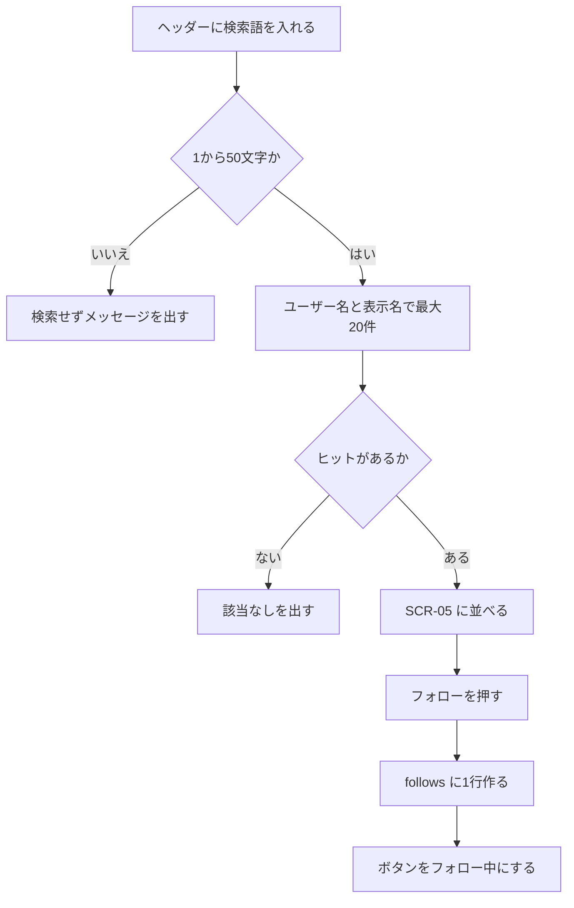
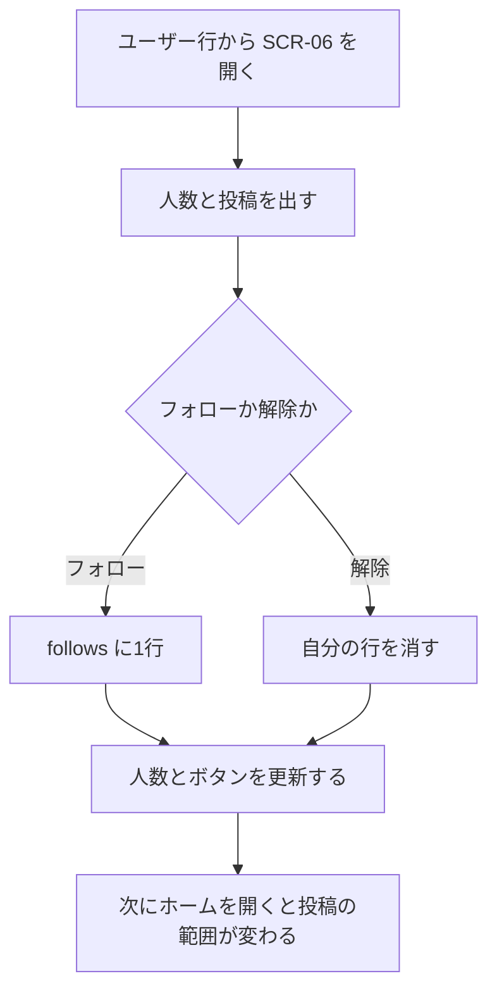
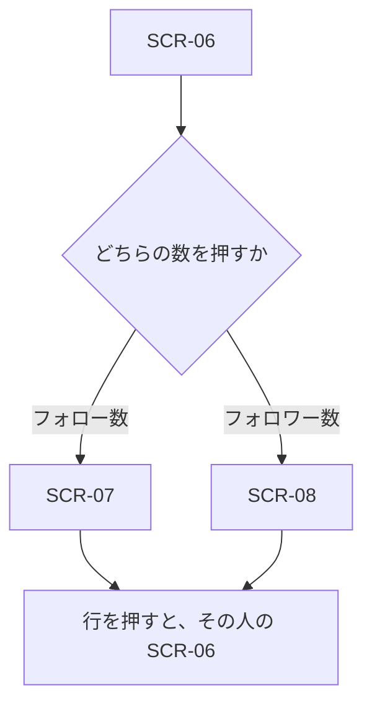

# 機能定義：フォロー

| 項目 | 内容 |
|---|---|
| 文書名 | 機能定義（フォロー） |
| 対象システム | 学習用SNS（X風のタイムラインアプリ） |
| 版 | 1.0 |
| 作成日 | 2026年10月30日 |
| 作成者 | nsb |
| 関連資料 | 用語定義書、要件定義書、機能要件、画面設計書、データベース設計、機能定義/タイムライン |
| 目的 | ユーザーの探し方、フォロー、フォロワー、プロフィールの範囲・流れ・完成条件を決める |
| 機能No. | F-1、F-2、F-3、F-4、F-5、F-6、F-7 |

言葉の意味は「用語定義書」に従います。ホームに出る投稿の条件は「機能定義/タイムライン」を正とします。

---

## 1. 目的

ホームはフォロー中の人の投稿だけなので、フォローする相手を探す手段が要る。探す対象はユーザーである。投稿本文からは探さない。

| 項目 | 内容 |
|---|---|
| 対象 | ログイン中のユーザー |
| 中心の操作 | ヘッダーの検索、結果からのフォロー、プロフィール |
| 保存 | フォローは follows に1行。解除はその行の削除。人数の列は持たない |

---

## 2. 範囲

### 2.1 今回作る

| No. | 内容 |
|---|---|
| F-1 | ユーザー名と表示名でユーザーを検索する |
| F-2 | プロフィールと、その人の投稿一覧を表示する |
| F-3 | フォローする |
| F-4 | フォローを解除する |
| F-5 | フォロー中一覧を表示する |
| F-6 | フォロワー一覧を表示する |
| F-7 | フォロー数とフォロワー数を表示する |

### 2.2 今回作らない

- 投稿本文、コメント本文の検索
- ハッシュタグ
- 検索結果の21件目以降、ページ番号
- フォローの承認、非公開アカウント
- ブロック、ミュート
- 相互フォローだけの絞り込みやバッジ
- おすすめユーザー
- フォローしたことを知らせる通知

---

## 3. ユーザー検索の規則（F-1）

検索は、フォローしたい人を見つけるための機能である。

### 3.1 入口

ログイン後の共通ヘッダーに検索欄を置く。検索語を入れて Enter または「検索」を押すと、SCR-05 に結果を出す。検索欄は SCR-03〜SCR-08 で同じである。

未ログインのヘッダーは無い。未ログインでは検索しない。

### 3.2 検索語

| 規則 | 内容 |
|---|---|
| 前後の空白 | 除いてから判定する |
| 空 | 除いたあと0文字なら検索しない。「ユーザー名または表示名を入力してください。」の趣旨 |
| 長さ | 1〜50文字。51文字以上は検索しない |
| 対象の列 | users.username と users.display_name だけ |
| 対象外 | 投稿本文、コメント、メールアドレス。メールアドレスが検索語と一致しても、それだけではヒットさせない |
| 一致 | 部分一致。大文字小文字は区別しない |
| ユーザー名の照合 | 検索語の全角英数字は半角に揃えてから、username と比べる |
| 表示名の照合 | 空白を除いた検索語の部分一致。大文字小文字は区別しない |
| 自分 | 条件に合うなら結果に出す。フォローボタンは出さない |
| 件数 | 最大20件 |
| 21件目がありうるとき | 20件だけ出し、「条件を短く絞ってください。」の趣旨を添える。続きのページは作らない |

ヒット条件は、ユーザー名が部分一致するか、表示名が部分一致するか、のどちらかである。

### 3.3 並び

上から次の順でグループを分け、グループの中はユーザー名の昇順（大文字小文字は区別しない）とする。

1. ユーザー名が検索語で始まる
2. 表示名が検索語で始まる。ただしグループ1に入った人は除く
3. それ以外の部分一致

例: 検索語 `ada` のとき、ユーザー名 `ada` はグループ1、表示名だけが `Ada` で始まる人はグループ2、ユーザー名 `madam` はグループ3である。

### 3.4 結果の1行

| 項目 | 内容 |
|---|---|
| アイコン | そのユーザーのアイコン。無いときは表示名の先頭1文字 |
| 表示名 | そのユーザーの表示名 |
| ユーザー名 | `@` 付き |
| フォロワー数 | その人を followee にする follows の行数 |
| ボタン | 未フォローなら「フォロー」。フォロー済みなら「フォロー中」。自分の行にはボタンを出さない |
| 行のクリック | 表示名またはユーザー名で SCR-06 のその人のプロフィールへ進む。ボタンのクリックは遷移しない |

0件のときは「該当するユーザーがいません。」の趣旨を出す。検索欄の語は残す。

---

## 4. フォローの規則（F-3、F-4）

| 規則 | 内容 |
|---|---|
| 向き | 片方向。follower が followee の投稿を、自分のフォロー中タブに含める |
| 承認 | 要らない。押した時点で1行できる |
| 自分自身 | follows に入れない。ボタンも出さない |
| 一意 | `(follower_id, followee_id)` が1組につき1行 |
| 相互 | 逆向きの行が別に存在するだけである。特別な列や画面状態は作らない |
| 解除 | ログイン中のユーザーが follower である行だけを消す |
| フォロー中タブ | フォローしたあと、相手の既存の投稿もフォロー中タブの新しい順に含まれる。解除後はそのタブから外れる。全体タブと posts は残る |
| 操作できる場所 | SCR-05 の結果、SCR-06、SCR-07、SCR-08。押したあとはその場のボタンと件数を更新し、画面は遷移しない |

---

## 5. プロフィールと一覧（F-2、F-5、F-6、F-7）

### 5.1 プロフィール

SCR-06 に次を出す。

| 項目 | 内容 |
|---|---|
| アイコン | そのユーザーのアイコン。無いときは表示名の先頭1文字 |
| 表示名、ユーザー名 | そのユーザー |
| 自己紹介 | users.bio。空なら領域自体を出さない |
| フォロー数 | そのユーザーが follower である follows の行数。押すと SCR-07 |
| フォロワー数 | そのユーザーが followee である follows の行数。押すと SCR-08 |
| フォローボタン | 他人のプロフィールだけ。規則は第4章 |
| 投稿 | その user_id の posts を新しい順。フォローしていなくても出す。カードの項目はホームと同じ |

自分のプロフィールは、共通ヘッダーの自分の表示から開く。フォローボタンは出さない。

存在しないユーザーIDのときは、見つからないことを伝え、ホームへ戻る手段を残す。

### 5.2 一覧

| 画面 | 中身 | 順 |
|---|---|---|
| SCR-07 フォロー中 | プロフィールの本人がフォローしているユーザー | follows.created_at の新しい順 |
| SCR-08 フォロワー | プロフィールの本人をフォローしているユーザー | follows.created_at の新しい順 |

各行の項目は検索結果と同じである。フォローボタンは、ログイン中のユーザーから見た関係で出す。一覧の所有者ではなく、いま操作している人がフォロー済みかどうかである。

0件のときは、まだ誰もいない旨を出す。

今回、一覧のページ分割はしない。学習用の人数を一度に出してよい。

---

## 6. 操作フロー

### 6.1 UF-F1 検索してフォローする

| 項目 | 内容 |
|---|---|
| 種類 | 操作フロー |
| 対応する機能 | F-1、F-3 |

### 6.2 UF-F2 プロフィールからフォローする

| 項目 | 内容 |
|---|---|
| 種類 | 操作フロー |
| 対応する機能 | F-2、F-3、F-4、F-7 |

### 6.3 UF-F3 人数から一覧を開く

| 項目 | 内容 |
|---|---|
| 種類 | 操作フロー |
| 対応する機能 | F-5、F-6 |

---

## 7. 例外

| 状況 | 扱い |
|---|---|
| 検索語が空 | 検索しない |
| 検索語が51文字以上 | 検索しない |
| 21件以上 | 20件と絞り込みの案内 |
| 0件 | 該当なし |
| 自分をフォロー | ボタンを出さない。APIでも行を作らない |
| すでにフォロー済み | 2行目は作らない。ボタンは「フォロー中」 |
| 解除対象の行が無い | 未フォローの表示にする |
| ユーザーが存在しない | プロフィールを出さない |
| 未ログイン | SCR-01 へ送る |
| API に失敗 | 押す前のボタンに戻し、失敗を伝える |

---

## 8. 画面とデータ

| 機能 | 画面 | データ |
|---|---|---|
| F-1 | SCR-05 | users を読む。行は増えない |
| F-2 | SCR-06 | users と、その posts |
| F-3 | SCR-05、SCR-06、SCR-07、SCR-08 | follows に INSERT |
| F-4 | 同上 | 自分の follows を DELETE |
| F-5 | SCR-07 | follower_id がその人である follows |
| F-6 | SCR-08 | followee_id がその人である follows |
| F-7 | SCR-06 | follows の COUNT |

---

## 9. 完成とみなす条件

1. ユーザー名の一部で検索でき、表示名の一部でも検索できる
2. 投稿本文にだけ含まれる語では、ユーザーはヒットしない
3. 結果は最大20件で、第3.3節の順である
4. 結果またはプロフィールからフォローでき、自分自身はフォローできない
5. フォロー後、相手の投稿がフォロー中タブに出る。解除後はそのタブから外れる。全体タブには残る
6. プロフィールのフォロー数とフォロワー数が、一覧の人数と一致する
7. 相互フォロー専用の表示が無い
8. 承認待ちの状態が無い

---

## 10. 改訂履歴

| 版 | 日付 | 内容 |
|---|---|---|
| 1.0 | 2026年10月30日 | 初版。ユーザー検索の一致、件数、並び、フォローとの関係を決めた |
