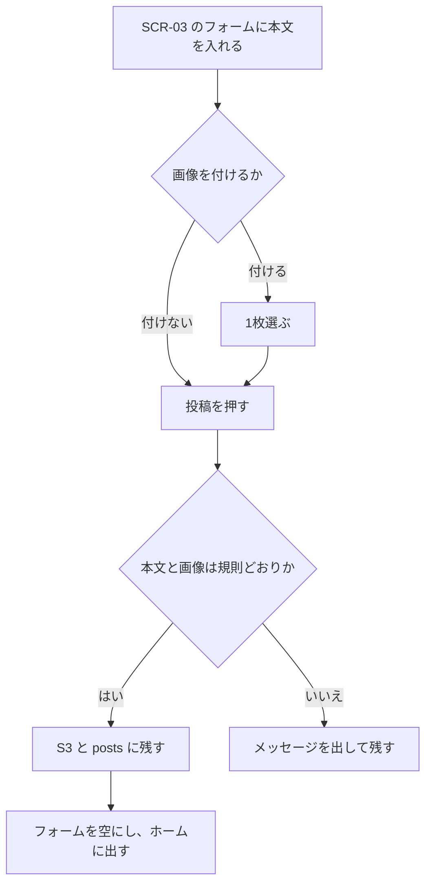
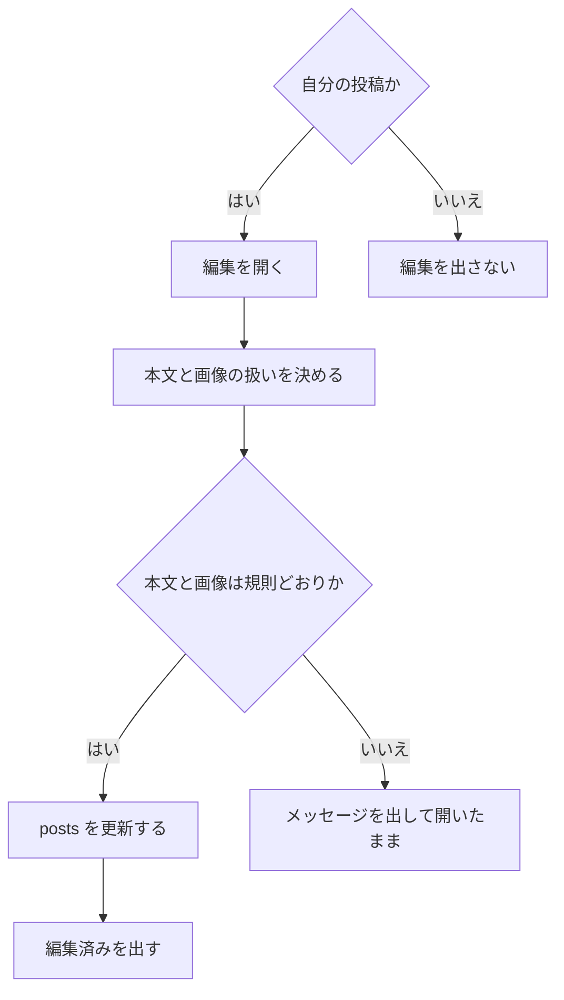
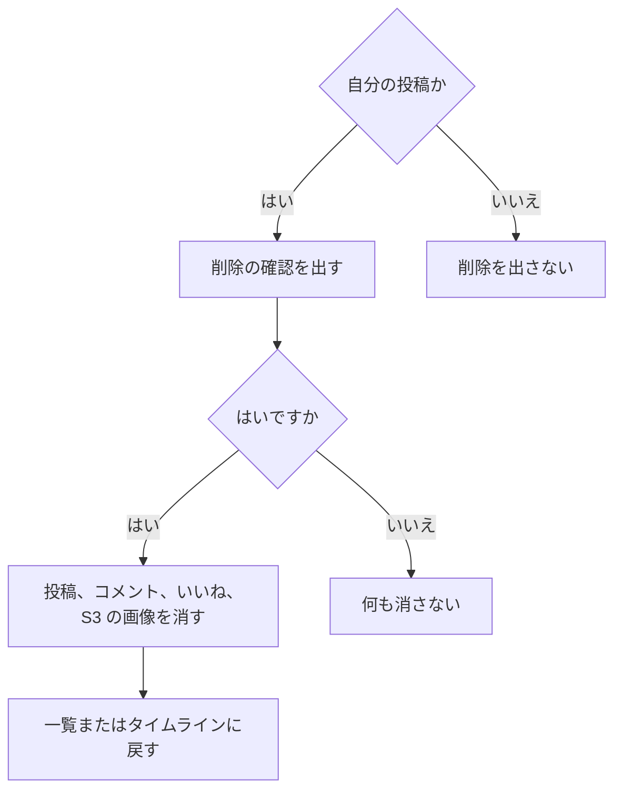

# 機能定義：投稿

| 項目 | 内容 |
|---|---|
| 文書名 | 機能定義（投稿） |
| 対象システム | 学習用SNS（X風のタイムラインアプリ） |
| 版 | 1.1 |
| 作成日 | 2026年10月30日 |
| 作成者 | nsb |
| 関連資料 | 用語定義書、要件定義書、機能要件、画面設計書、データベース設計、技術スタック、インフラ構成 |
| 目的 | 投稿の作成、編集、削除の範囲・流れ・完成条件を決める |
| 機能No. | P-1、P-2、P-3 |

言葉の意味は「用語定義書」に従います。ホームでの並びは「機能定義/タイムライン」を正とします。

---

## 1. 目的

ログイン中のユーザーが、本文と、任意で画像1枚を公開の投稿として残す。自分の投稿はあとから直し、確認のあと消せる。

| 項目 | 内容 |
|---|---|
| 対象 | ログイン中のユーザー |
| 中心の操作 | ホーム上部の投稿フォーム |
| 保存 | posts に1行。画像があるときだけ S3 に1オブジェクト |

---

## 2. 範囲

### 2.1 今回作る

| No. | 内容 |
|---|---|
| P-1 | 本文必須、画像任意1枚で投稿する。成功すると、いま開いているタブの条件に合うなら、新しい順の位置に出る |
| P-2 | 自分の投稿の本文を直し、画像を維持、差し替え、または削除する |
| P-3 | 自分の投稿を、確認のあと削除する |

### 2.2 今回作らない

- 下書き
- 画像2枚以上、動画、画像だけの投稿（本文が空）
- 投稿の宛先指定、非公開投稿

---

## 3. 規則

| 項目 | 約束 |
|---|---|
| 本文 | 必須。前後の空白を除いて1〜280文字。改行は1文字として数える。改行は保存し、表示でも維持する |
| 画像 | 任意。0枚または1枚 |
| 形式 | JPEG、PNG、WebP。拡張子ではなく中身の形式で判断する |
| 大きさ | 5MB以下。この値は仮。変えるときは要件定義書の版も上げる |
| 保存 | ファイル本体は S3。posts.image_key にオブジェクトキーを入れる。画像が無い投稿は image_key を NULL にする |
| 公開 | S3 のオブジェクトは公開読み取りにしない。表示用のURLは API がその都度、期限付きで発行する |
| 投稿者 | ログイン中のユーザー。JWT から決める。クライアントが送ったユーザーIDは採用しない |
| 編集できる人 | その投稿の user_id と、JWT のユーザーが同じときだけ。ボタンもそのときだけ出す |
| 編集の画像 | 維持、新しい1枚への差し替え、画像なしへの変更。差し替えと削除では、古い S3 オブジェクトを消す |
| 編集日時 | 本文または画像を変えて保存したとき `updated_at` を今にする。`created_at` は変えない。画面は「編集済み」を出す |
| 削除 | 確認ではいのとき、その posts と、その post_id の comments と likes を消す。image_key があれば S3 も消す。いいえでは何も消さない |
| 失敗時 | posts の行と S3 のオブジェクトが片方だけ残らないようにする。画像の保存に失敗したら、作成も編集も確定しない |

フォームは、選んだ画像の有無が投稿前に分かるようにする。2枚目は選べない。

---

## 4. 操作フロー

### 4.1 UF-P1 投稿する

| 項目 | 内容 |
|---|---|
| 種類 | 操作フロー |
| 対応する機能 | P-1 |

### 4.2 UF-P2 編集する

| 項目 | 内容 |
|---|---|
| 種類 | 操作フロー |
| 対応する機能 | P-2 |

### 4.3 UF-P3 削除する

| 項目 | 内容 |
|---|---|
| 種類 | 操作フロー |
| 対応する機能 | P-3 |

詳細画面で削除したあとは SCR-03 の、削除前に見ていたタブへ戻す。

---

## 5. 例外

| 状況 | 扱い |
|---|---|
| 本文が空 | 「本文を入力してください。」の趣旨。投稿しない |
| 本文が281文字以上 | 280文字以下であることを伝える。投稿しない |
| 形式が JPEG / PNG / WebP 以外 | 形式が違うことを伝える。投稿しない |
| 5MBを超える | 上限を伝える。投稿しない |
| 未ログイン | SCR-01 へ送る。行もオブジェクトも作らない |
| S3 または API に失敗 | できなかったことを伝える。中途半端な行を残さない |
| 他人の投稿を編集または削除する | 受け付けない。ボタンも出さない |

---

## 6. 画面とデータ

| 機能 | 画面 | データ |
|---|---|---|
| P-1 | SCR-03 | posts に INSERT。画像があるとき S3 に PUT。updated_at の初期値は created_at |
| P-2 | 自分のカードがある SCR-03、SCR-04、SCR-06 | posts を UPDATE。画像の増減があれば S3 |
| P-3 | 同上 | posts と、その comments、likes を DELETE。画像があれば S3 も DELETE |

ホームとプロフィールと投稿詳細は、この行を読む。読み方はタイムラインの定義を正とする。

---

## 7. 完成とみなす条件

1. 本文だけで投稿でき、ホームに出る
2. 画像1枚を添えて投稿でき、カードに画像が出る
3. 画像のない投稿に、空の画像領域を出さない
4. 空の本文、長すぎる本文、形式違い、5MB超では投稿されない
5. 画像ファイルが PostgreSQL の中にバイト列で入っていない
6. S3 のオブジェクトを、バケットの公開URLだけでは読めない
7. 自分の投稿を編集でき、編集済みと分かる
8. 自分の投稿を削除すると、そのコメントといいねも消え、一覧から外れる
9. 他人の投稿に編集と削除が出ない

---

## 8. 改訂履歴

| 版 | 日付 | 内容 |
|---|---|---|
| 1.0 | 2026年10月30日 | 初版 |
| 1.1 | 2026年10月30日 | 自分の投稿の編集と削除を加えた |
