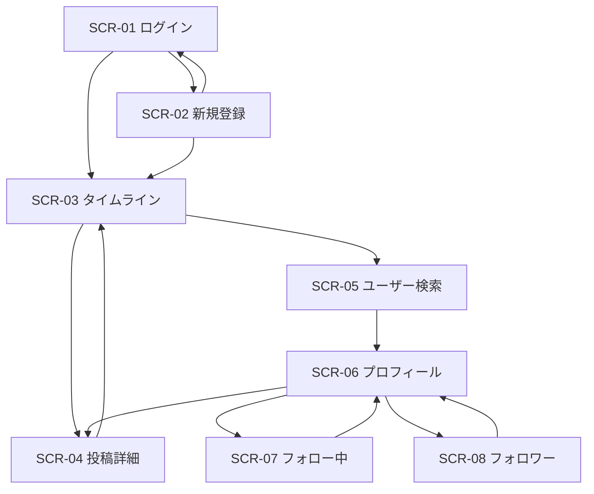

# 画面設計書

| 項目 | 内容 |
|---|---|
| 文書名 | 画面設計書 |
| 対象システム | 学習用SNS（X風のタイムラインアプリ） |
| 版 | 1.0 |
| 作成日 | 2026年10月30日 |
| 改訂日 | 2026年10月30日 |
| 作成者 | nsb |
| 関連資料 | 用語定義書、要件定義書、機能要件、機能定義 |
| 目的 | 画面の配置と、各部品の役割を決める |

言葉の意味は「用語定義書」に従います。作る機能の範囲は「要件定義書」に従います。  
色や余白の詳細は、この資料では決めません。構成と、押したときの役割を決めます。

---

## 1. 画面一覧

| 画面ID | 画面名 | 種類 | 説明 |
|---|---|---|---|
| SCR-01 | ログイン | ログイン前 | 入る |
| SCR-02 | 新規登録 | ログイン前 | アカウントを作る |
| SCR-03 | タイムライン | ログイン後 | 投稿の作成とホーム |
| SCR-04 | 投稿詳細 | ログイン後 | 投稿1件とコメント |
| SCR-05 | ユーザー検索 | ログイン後 | 検索結果 |
| SCR-06 | プロフィール | ログイン後 | 1人の情報と投稿 |
| SCR-07 | フォロー中一覧 | ログイン後 | その人がフォローしている人 |
| SCR-08 | フォロワー一覧 | ログイン後 | その人をフォローしている人 |

### 1.1 画面遷移

未ログインで SCR-03 以降を開いた場合は SCR-01 へ送る。ログイン済みで SCR-01 または SCR-02 を開いた場合は SCR-03 へ送る。

いいね、フォロー、フォロー解除は画面遷移ではない。押した画面のボタンと件数だけを更新する。



共通ヘッダーの検索は、どのログイン後画面からでも SCR-05 へ進む。ログアウトは SCR-01 へ進む。自分の名前は、自分の SCR-06 へ進む。

---

## 2. 共通ヘッダー

SCR-03 から SCR-08 の上部に置く。SCR-01 と SCR-02 には置かない。

```text
学習用SNS    [ユーザーを検索] [検索]    自分の表示名    ログアウト
```

| No. | 部品名 | 種類 | 動作 |
|---|---|---|---|
| 1 | アプリ名 | 見出し | 「学習用SNS」。押すと SCR-03 |
| 2 | 検索語 | 入力 | ユーザー名または表示名。最大50文字 |
| 3 | 検索 | ボタン | Enter でも同じ。規則を満たすと SCR-05。空や51文字以上では遷移せずメッセージ |
| 4 | 自分の表示名 | リンク | 自分の SCR-06 |
| 5 | ログアウト | ボタン | 確認なしで SCR-01（A-3） |

---

## 3. 投稿カード

SCR-03、SCR-04、SCR-06 で同じ項目を出す。SCR-04 ではカードの下にコメント欄が続く。

```text
表示名  @username                 日時
本文
[画像があるときだけ画像]
[いいね] 件数     コメント 件数
```

| 項目 | 動作 |
|---|---|
| 表示名、ユーザー名 | 押すとその人の SCR-06 |
| 本文、余白 | SCR-03 と SCR-06 では SCR-04 へ進む。SCR-04 では遷移しない |
| 画像 | 本文と同じく詳細へ進む。画像が無い投稿では領域を出さない |
| いいね | 遷移しない。未いいねなら L-1、済みなら L-2。見た目で状態が分かる |
| いいね数 | L-3。0も出す。押しても遷移しない |
| コメント数 | L-3。SCR-03 と SCR-06 では押すと SCR-04。0も出す |

置かない部品は、インプレッション、リポスト、コメントへのいいねである。

---

## 4. ログイン（SCR-01）

### 4.1 レイアウト

```text
ログイン
[ユーザー名またはメールアドレス]
[パスワード]
[ログイン]
新規登録へ
```

### 4.2 部品

| No. | 部品名 | 種類 | 動作 |
|---|---|---|---|
| 1 | ユーザー名またはメールアドレス | 入力 | 必須 |
| 2 | パスワード | 入力 | 必須。文字はマスクする |
| 3 | ログイン | ボタン | 成功で SCR-03。失敗時は留まる（A-2） |
| 4 | 新規登録へ | リンク | SCR-02 |
| 5 | メッセージ | 文字 | 失敗のときだけ出す |

失敗の文は「ユーザー名またはパスワードが違います。」の趣旨とする。ユーザーの有無とパスワードの正否は分けない。

---

## 5. 新規登録（SCR-02）

### 5.1 レイアウト

```text
新規登録
[表示名]
[ユーザー名]
[メールアドレス]
[パスワード]
[登録]
ログインへ
```

### 5.2 部品

| No. | 部品名 | 種類 | 動作 |
|---|---|---|---|
| 1 | 表示名 | 入力 | 必須。1〜50文字 |
| 2 | ユーザー名 | 入力 | 必須。`@` は付けない。4〜15文字。半角英字で始まる |
| 3 | メールアドレス | 入力 | 必須 |
| 4 | パスワード | 入力 | 必須。8文字以上。文字はマスクする |
| 5 | 登録 | ボタン | 成功でログイン状態の SCR-03（A-1） |
| 6 | ログインへ | リンク | SCR-01 |
| 7 | メッセージ | 文字 | 重複や形式のとき、どの項目かを出して留まる |

---

## 6. タイムライン（SCR-03）

### 6.1 レイアウト

```text
[共通ヘッダー]

投稿する
[本文]
[画像を1枚選ぶ]
[投稿]

--- 新しい順 ---
[投稿カード]
[投稿カード]
```

### 6.2 投稿フォーム

| No. | 部品名 | 種類 | 動作 |
|---|---|---|---|
| 1 | 本文 | 入力 | 必須。1〜280文字。残り文字数が分かるとよい |
| 2 | 画像 | ファイル1枚 | 任意。選び直しができる。添付の有無が分かる |
| 3 | 投稿 | ボタン | 成功でフォームを空にし、カードを新しい順の位置に出す（P-1） |
| 4 | メッセージ | 文字 | 本文や画像が規則外のとき |

### 6.3 空のとき

カードが0件のときは、カードの代わりに「フォローしているユーザーの投稿がありません。ユーザーを検索してフォローできます。」の趣旨と、検索欄へ意識が向く文言を出す。フォームは残す。

---

## 7. 投稿詳細（SCR-04）

### 7.1 レイアウト

```text
[共通ヘッダー]
タイムラインへ戻る

[投稿カード]

コメントする
[本文]
[コメント]

--- 古い順 ---
表示名  @username    日時
本文
```

### 7.2 部品

| No. | 部品名 | 種類 | 動作 |
|---|---|---|---|
| 1 | タイムラインへ戻る | リンク | SCR-03 |
| 2 | 投稿カード | カード | 第3章。いいねはその場で更新 |
| 3 | コメント本文 | 入力 | 必須。1〜280文字。画像の入力は置かない |
| 4 | コメント | ボタン | 成功で入力を空にし、一覧の末尾に足す。コメント数も増える（C-1） |
| 5 | コメント一覧 | 一覧 | 表示名、ユーザー名、日時、本文。名前は SCR-06 へ（C-2） |

コメントが0件のときは「まだコメントがありません。」の趣旨を出す。入力欄は残す。各コメントにいいねも返信も置かない。

投稿が無いときは、カードと入力欄を出さず、見つからない旨とホームへ戻るリンクを出す。

---

## 8. ユーザー検索（SCR-05）

### 8.1 レイアウト

```text
[共通ヘッダー]

「検索語」の結果
[20件を超えるときだけ、絞り込みの案内]

表示名  @username    フォロワー数    [フォロー]
表示名  @username    フォロワー数    [フォロー中]
```

### 8.2 部品

| No. | 部品名 | 種類 | 動作 |
|---|---|---|---|
| 1 | 見出し | 文字 | どの語で探したかを出す |
| 2 | 案内 | 文字 | 21件目がありうるときだけ |
| 3 | ユーザー行 | 行 | 表示名またはユーザー名で SCR-06 |
| 4 | フォロワー数 | 文字 | その人のフォロワー数 |
| 5 | フォロー | ボタン | 他人だけ。押すとその場で F-3 または F-4。遷移しない |

0件のときは「該当するユーザーがいません。」の趣旨を出す。並びと20件の上限は、機能定義/フォローの第3章を正とする。

---

## 9. プロフィール（SCR-06）

### 9.1 レイアウト

```text
[共通ヘッダー]

表示名  @username
[フォロー] またはボタンなし
フォロー数    フォロワー数

--- この人の投稿。新しい順 ---
[投稿カード]
```

### 9.2 部品

| No. | 部品名 | 種類 | 動作 |
|---|---|---|---|
| 1 | 表示名、ユーザー名 | 見出し | 書き換えない |
| 2 | フォロー | ボタン | 他人のプロフィールだけ。その場で F-3 または F-4 |
| 3 | フォロー数 | リンク | SCR-07。0も出す |
| 4 | フォロワー数 | リンク | SCR-08。0も出す |
| 5 | 投稿カード | カード | その人の投稿だけ。新しい順。0件のときはまだ投稿が無い旨 |

自分のプロフィールにはフォローボタンを出さない。ユーザーが存在しないときは、見つからない旨とホームへのリンクを出す。

---

## 10. フォロー中一覧（SCR-07）とフォロワー一覧（SCR-08）

レイアウトは同じである。見出しだけが違う。

```text
[共通ヘッダー]
プロフィールへ戻る

フォロー中
表示名  @username    フォロワー数    [フォロー]
```

SCR-08 の見出しは「フォロワー」である。

| No. | 部品名 | 種類 | 動作 |
|---|---|---|---|
| 1 | プロフィールへ戻る | リンク | 一覧の所有者の SCR-06 |
| 2 | 見出し | 文字 | SCR-07 はフォロー中。SCR-08 はフォロワー |
| 3 | ユーザー行 | 行 | SCR-05 と同じ項目。名前でその人の SCR-06 |
| 4 | フォロー | ボタン | ログイン中のユーザーから見た関係。自分の行には出さない。遷移しない |

0件のときは、まだ誰もいない旨を出す。並びは関係の新しい順である。

---

## 11. 画面と機能の対応

| 画面 | 機能 |
|---|---|
| SCR-01 | A-2 |
| SCR-02 | A-1 |
| 共通ヘッダー | A-3、F-1 の入口 |
| SCR-03 | P-1、T-1、L-1、L-2、L-3 |
| SCR-04 | T-2、C-1、C-2、L-1、L-2、L-3 |
| SCR-05 | F-1、F-3、F-4 |
| SCR-06 | F-2、F-3、F-4、F-7、T-2 への入口、L-1、L-2、L-3 |
| SCR-07 | F-5、F-3、F-4 |
| SCR-08 | F-6、F-3、F-4 |

---

## 12. 改訂履歴

| 版 | 日付 | 内容 |
|---|---|---|
| 1.0 | 2026年10月30日 | 初版。8画面。検索、プロフィール、フォロー一覧を含めた |
