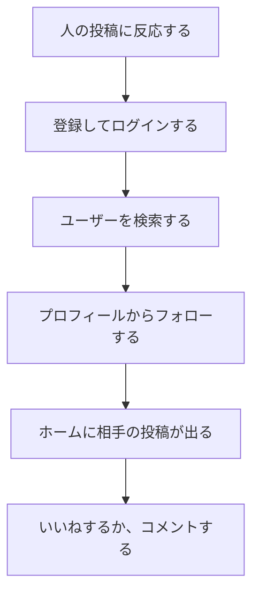
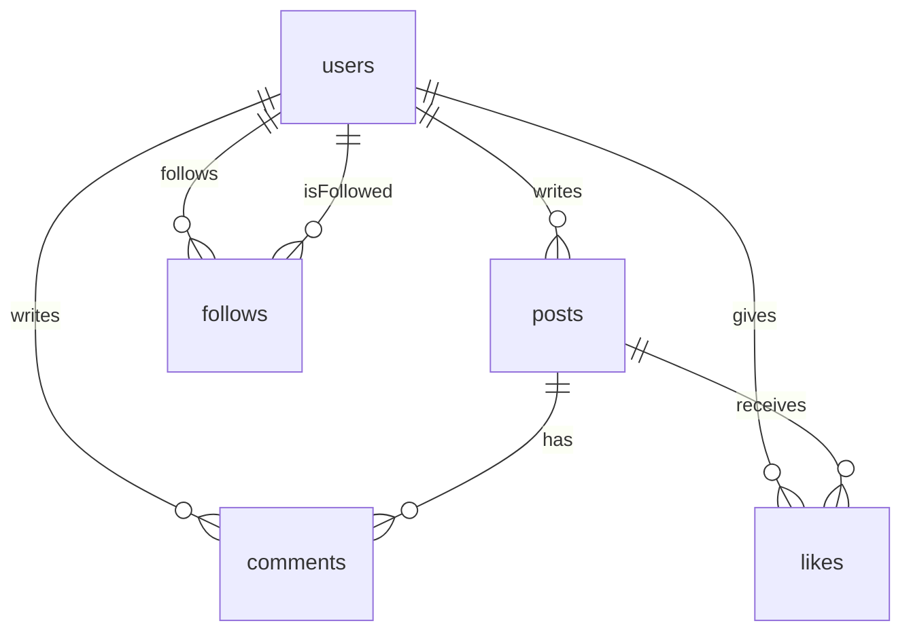
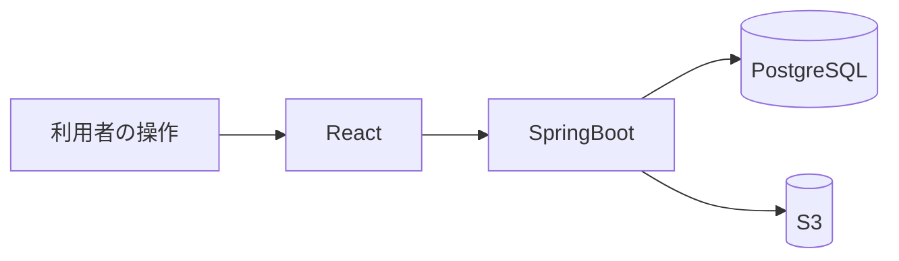

# 要件定義書

| 項目 | 内容 |
|---|---|
| 文書名 | 要件定義書 |
| 対象システム | 学習用SNS（X風のタイムラインアプリ） |
| 版 | 1.1 |
| 作成日 | 2026年10月30日 |
| 改訂日 | 2026年10月30日 |
| 作成者 | nsb |
| レビュー | 提出先（授業の提出をもって確認とする） |
| 承認 | なし。学習課題のため、提出が確認にあたる |
| 機密 | 学習課題の提出資料。社外秘などの扱いではない |
| 関連資料 | 用語定義書、機能要件、機能定義、画面設計書、ER図、データベース設計、技術スタック、インフラ構成 |
| 目的 | 本システムで「何を作るか」「何を作らないか」を決める |

この資料は、プログラムを書く前に決める約束事です。言葉の意味は「用語定義書」に従います。  
授業の提出・説明用であり、本番システムの運用契約（SLA）ではありません。  
資料の分け方は、課題管理ボード（デスクトップの「アプリケーション」）に合わせています。

番号付きのできることは、この第3章に要約し、一覧の正は「機能要件」とします。機能ごとの流れと完成条件は「機能定義」に分けます。

---

## 1. 背景と目的

学校の学習課題として、要件を決めてから画面とデータを設計し、そのあと実装する流れを体験するために作る。

Xのタイムラインに近い操作で、文章を投稿し、他の人の投稿を見て、コメントし、いいねする。複数のアカウントで、互いの投稿に反応できる。

Xとの違いは次の2点である。

- インプレッション数を表示しない。回数も保存しない
- リポスト（リツイート）や引用を作らない

ホームはタブで切り替える。全体は全ユーザーの投稿、フォロー中は自分の投稿とフォローしているユーザーの投稿である。どちらも新しい順である。人を見つける手段はユーザー検索である。投稿本文の検索はしない。

ログインしたあとの操作は JWT で認める。サーバセッションは使わない。ユーザーは任意でアイコンと自己紹介を持てる。自分の投稿は編集と削除ができる。

画像の保存先は Amazon S3 に決めた。API と PostgreSQL を AWS の EC2 と RDS に置き、入口を ALB にするかは、まだ実施を決めていない。置く場合の箱の並びは「インフラ構成」を正とする。

---

## 2. 利用者と利用の前提

| 項目 | 内容 |
|---|---|
| 利用者（操作する人） | 受講生または個人。複数人が同時に使う |
| 説明先 | 提出先（教員・レビューする人）。資料の読み手であり、必ずしもアプリの利用者ではない |
| 画面の数 | 8枚（SCR-01〜SCR-08）。ログイン前はログインと新規登録だけ |
| ログイン | あり。成功時に JWT を返す。未ログインでは投稿、コメント、いいね、フォロー、ユーザー検索はできない |
| 他の人との関係 | フォローは片方向。承認は要らない。いいねとコメントは、ログインしていれば相手の投稿に対してできる |
| 動かす場所 | 開発中は自分のパソコンの Chrome または Edge。Vite の画面を開く |
| ネットワーク | 開発中は localhost。AWS へ載せる作業は未決定 |
| 文章の保存 | PostgreSQL。開発中は手元の Docker。AWS に載せる場合は RDS |
| 画像の保存 | Amazon S3。表にはオブジェクトキーだけを残す |

---

## 3. 機能要件

機能要件とは、「ユーザーがこのアプリでできること」です。詳細な流れは機能定義、番号の一覧は機能要件を正とします。

### 3.1 アカウント

| No. | できること | 詳細 |
|---|---|---|
| A-1 | ユーザー登録する | 表示名、ユーザー名、メールアドレス、パスワードでアカウントを作る。アイコンと自己紹介は任意。成功すると JWT を受け取り、ホームの全体タブへ進む |
| A-2 | ログインする | ユーザー名またはメールアドレスと、パスワードで入る。成功すると JWT を返す |
| A-3 | ログアウトする | 画面が持っている JWT を捨て、ログイン画面へ戻る。サーバセッションは無い |
| A-4 | アイコンと自己紹介を保存する | 自分のプロフィールだけ。アイコンは任意の画像1枚。自己紹介は空でもよく、160文字まで |

### 3.2 投稿

| No. | できること | 詳細 |
|---|---|---|
| P-1 | 投稿を作成する | 本文は必須で1〜280文字。画像は任意で1枚。JPEG、PNG、WebP。仮の上限は5MB。ファイルは S3 |
| P-2 | 投稿を編集する | 自分の投稿だけ。本文を直せる。画像は維持、差し替え、削除のいずれか |
| P-3 | 投稿を削除する | 自分の投稿だけ。確認のあと、その投稿のコメントといいね、S3 の画像も消す |

### 3.3 タイムライン

| No. | できること | 詳細 |
|---|---|---|
| T-1 | 全体タブを表示する | 全ユーザーの投稿を新しい順に出す。開いた直後のタブは全体 |
| T-2 | フォロー中タブを表示する | 自分の投稿と、フォロー中のユーザーの投稿を新しい順に出す |
| T-3 | 投稿詳細を表示する | 投稿1件と、そのコメント欄を出す |

### 3.4 コメント

| No. | できること | 詳細 |
|---|---|---|
| C-1 | コメントを追加する | 投稿に対して本文1〜280文字を1件追加する。画像は付けない |
| C-2 | コメント一覧を表示する | その投稿のコメントを古い順に出す。各コメントに書いた人のアイコンを出す |

### 3.5 いいね

| No. | できること | 詳細 |
|---|---|---|
| L-1 | いいねを追加する | まだいいねしていない投稿に、自分のいいねを1件付ける |
| L-2 | いいねを解除する | 自分のいいねを取り消す。他のユーザーのいいねは残る |
| L-3 | 件数を表示する | いいね数とコメント数を、ホームと投稿詳細に出す。件数は行を数えて求める |

### 3.6 フォローとユーザー検索

| No. | できること | 詳細 |
|---|---|---|
| F-1 | ユーザーを検索する | ユーザー名と表示名の部分一致。最大20件。投稿本文は探さない |
| F-2 | プロフィールを表示する | アイコン、表示名、ユーザー名、自己紹介、フォロー数、フォロワー数、その人の投稿を新しい順に出す |
| F-3 | フォローする | 相手の承認なしで、片方向のフォローを1件作る。自分自身は不可 |
| F-4 | フォローを解除する | 自分が作ったフォローを消す。相手の投稿はフォロー中タブから外れる。全体タブには残る |
| F-5 | フォロー中一覧を表示する | そのユーザーがフォローしている人を、関係が新しい順に出す |
| F-6 | フォロワー一覧を表示する | そのユーザーをフォローしている人を、関係が新しい順に出す |
| F-7 | フォロー数とフォロワー数を表示する | プロフィールに出す。行を数えて求める |

### 3.7 項目の約束

| 項目 | 必須 / 任意 | 内容 |
|---|---|---|
| 表示名 | 必須 | 1〜50文字。重複可 |
| ユーザー名 | 必須 | 4〜15文字。半角英字で始まり、続きは半角英数字または `_`。一意（大文字小文字は区別しない） |
| メールアドレス | 必須 | 一意。メールアドレスの形 |
| パスワード | 必須 | 8文字以上。平文では保存しない |
| 投稿の本文 | 必須 | 1〜280文字 |
| 投稿の画像 | 任意 | 0枚または1枚。JPEG / PNG / WebP。5MB以下 |
| コメントの本文 | 必須 | 1〜280文字。画像は不可 |
| 検索語 | 必須 | 前後の空白を除いて1文字以上、50文字以下 |
| 自己紹介 | 任意 | 空でもよい。入れるなら160文字以下 |
| アイコン | 任意 | 0枚または1枚。JPEG / PNG / WebP。5MB以下。ファイルは S3 |

---

## 4. ユースフローと操作フロー

- **ユースフロー**：やりたいことを達成する道筋
- **操作フロー**：画面上のクリックなどの手順

図は GitHub の Mermaid で書く。操作の詳細は機能定義を正とする。部品の詳細は画面設計書を正とする。

### 4.1 全体（人を見つけて反応する）

| 項目 | 内容 |
|---|---|
| 種類 | ユースフロー |
| 対応する機能 | A-1、F-1、F-3、T-1、L-1、C-1 |

### 4.2 操作フローの置き場所

| ID | 内容 | 定義書 |
|---|---|---|
| UF-A | 登録、ログイン、ログアウト | 機能定義/アカウント |
| UF-P | 投稿を作成、編集、削除する | 機能定義/投稿 |
| UF-T | 全体、フォロー中、投稿詳細を見る | 機能定義/タイムライン |
| UF-C | コメントする | 機能定義/コメント |
| UF-L | いいねを付ける、外す | 機能定義/いいね |
| UF-F | 検索、フォロー、一覧、プロフィール | 機能定義/フォロー |

---

## 5. 画面要件

画面の部品・最大文字数の正は「画面設計書」とする。この節では画面の役割だけを書く。

| 画面ID | 画面名 | 役割 |
|---|---|---|
| SCR-01 | ログイン | ユーザー名またはメールアドレスとパスワードで入り、JWT を受け取る |
| SCR-02 | 新規登録 | アカウントを作る。成功時も JWT を受け取る |
| SCR-03 | タイムライン | 投稿を作成し、全体とフォロー中を切り替える。いいねできる |
| SCR-04 | 投稿詳細 | 投稿1件、コメント一覧、コメント入力、いいね。自分の投稿なら編集と削除 |
| SCR-05 | ユーザー検索 | 検索語に合うユーザーを最大20件出す。アイコンを出す |
| SCR-06 | プロフィール | アイコン、自己紹介、フォロー、その人の投稿。自分ならアイコンと自己紹介を保存できる |
| SCR-07 | フォロー中一覧 | その人がフォローしているユーザー |
| SCR-08 | フォロワー一覧 | その人をフォローしているユーザー |

ログイン後の画面（SCR-03〜SCR-08）は、共通ヘッダーにアプリ名、ユーザー検索、自分のプロフィールへの導線、ログアウトを置く。以降の API 呼び出しは、受け取った JWT を `Authorization: Bearer` で送る。

インプレッション数とリポストの部品は置かない。コメントにいいねボタンは置かない。タブの切り替えは画面遷移ではない。

画面の行き来は画面設計書の画面遷移図を正とする。

---

## 6. データと例外

### 6.1 保存と論理モデル

文章と関係は PostgreSQL の users、posts、comments、likes、follows の5表である。定義の正は「データベース設計」とする。画像ファイルは S3 に置き、posts には `image_key` だけを任意で持つ。

- いいね数、コメント数、フォロー数、フォロワー数の列は持たない
- いいねは `(post_id, user_id)` が一意
- フォローは `(follower_id, followee_id)` が一意。自分自身への行は作らない
- 全体タブは、全投稿を `created_at` の新しい順に出す
- フォロー中タブは、投稿者が自分であるか、投稿者が自分の followee である投稿を、同じ順に出す
- ユーザーは任意で `icon_key` と自己紹介を持つ。投稿は `updated_at` を持つ

### 6.2 例外

| 状況 | 扱い |
|---|---|
| 登録でユーザー名またはメールが重複 | 登録しない。どちらが重複かを伝える |
| ログインの組み合わせが一致しない | ログインしない。パスワードの正否は個別に明かさない |
| 投稿・コメントの本文が空、または281文字以上 | 保存しない |
| 画像が JPEG / PNG / WebP 以外、または5MBを超える | 投稿もアイコンも保存しない |
| 他人の投稿を編集または削除する | 受け付けない。ボタンも出さない |
| JWT が無い、または期限切れ | ログイン画面へ送る |
| 自己紹介が161文字以上 | 保存しない |
| 同じ投稿へ2件目のいいね | 作らない。画面では解除になる |
| 自分自身をフォローする | 作らない |
| 同じ相手へ2件目のフォロー | 作らない。画面では解除になる |
| 検索語が空白だけ、または51文字以上 | 検索しない |
| 検索が21件以上ヒットしうる | 20件まで出し、絞り込みが必要な旨を伝える |
| 未ログインで書き込みや検索を行う | ログイン画面へ送る |
| 投稿が存在しない | 見つからない旨を伝え、ホームへ戻る手段を残す |
| API に繋がらない | 接続を確認する旨を出す |

コメントの編集と削除は、今回の操作に無い。消してよい行は、自分の投稿（そのコメントといいねを含む）、自分のいいね、自分のフォローである。

---

## 7. データの流れ

操作は画面から API を呼び、文章と関係は PostgreSQL に書く。画像は API が S3 に書く。開き直すと、同じデータベースと S3 から読んで画面を描く。

開発中の PostgreSQL は手元の Docker である。AWS に載せる場合、PostgreSQL は RDS、API と画面は EC2、入口は ALB である。画像はどちらの場合も S3 である。

---

## 8. 非機能要件

数値のミリ秒は定めない。受講生が複数アカウントで学習する前提で、保証することと今回しないことを分ける。

### 8.1 動作環境

| 今回保証する | 今回しない |
|---|---|
| Windows のパソコンで、Chrome または Edge を使う | Safari や Firefox での動作保証 |
| 開発中の画面は Vite、API は Spring Boot | スマートフォン専用アプリ |

### 8.2 速さ（体感）

| 今回保証する | 今回しない |
|---|---|
| 学習用の件数なら、操作のあと画面が止まらず更新される | 応答時間のミリ秒、負荷試験、無限スクロールの性能保証 |

### 8.3 可用性

| 今回保証する | 今回しない |
|---|---|
| 開発中は、手元の API と PostgreSQL が動き、S3 へ届くこと | サーバの稼働率、24時間運用、障害窓口 |
| AWS へ載せる場合の箱の並びを、インフラ構成に書いておく | AWS への構築作業そのもの。実施は未決定 |

### 8.4 データの残り方

| 今回保証する | 今回しない |
|---|---|
| 投稿、コメント、いいね、フォローは PostgreSQL に残る | バックアップの運用手順、無期限保管の契約 |
| 画像ファイルは S3 に残る。投稿行にはキーだけを残す | 画像のCDN（CloudFront） |

### 8.5 セキュリティ

| 今回保証する | 今回しない |
|---|---|
| パスワードはハッシュで保存する。ログイン後の呼び出しは JWT で確認する。期限の仮値は24時間 | 二要素認証、リフレッシュトークン、監査ログ、通報、非公開アカウント |
| S3 は公開読み取りにしない。画面へ出す画像は API が期限付きURLで渡す | 投稿の暗号化、WAF の詳細設計 |

### 8.6 運用ログ

運用ログ、監視、障害対応の記録は、今回の完成条件に含めない。学習課題であるため。AWS に載せたあとに足す場合は、この資料を改訂してから追加する。

---

## 9. 技術の選定

使う技術の正は「技術スタック」とする。要約だけここに置く。課題管理ボードと同じく、画面は React（Vite）、API は Spring Boot（Java 21）、文章の保存は PostgreSQL、画面は JavaScript、API は Java である。課題管理ボードとの違いは、ログインを JWT にすること、画像を S3 に置くこと、AWS に載せる場合の入口を ALB にすることである。サーバセッションは使わない。

| 採用するもの | 理由 |
|---|---|
| React（Vite） | 画面をコンポーネントで組む。課題管理ボードと揃える |
| Spring Boot（Java 21） | JSON の REST API を書く。認証は JWT |
| JWT（jjwt） | ログイン状態を Bearer トークンで渡す。署名鍵は環境変数 |
| PostgreSQL + JDBC | SQL が見える。ORM は使わない |
| Amazon S3 | 画像の保存先として決めた |
| Chrome または Edge | 提出と説明で使うブラウザ |

| 採用しないもの | 理由 |
|---|---|
| Next.js、TypeScript、ORM | 課題管理ボードと同じく、今回の範囲では使わない |
| 画像を PostgreSQL のバイト列で持つ | ファイルは S3、キーだけを表に持つ |
| CloudFront、ElastiCache | 学習の第一段階の構成に含めない |
| サーバセッション | ログインは JWT に決めた |

AWS 上の ALB、EC2、RDS は「置く場合の前提」である。構築するかは未決定である。図の正は「インフラ構成」とする。

---

## 10. 対象外（今回作らないもの）

次は今回の範囲に含めない。必要になったら、この資料を改訂してから追加する。

- インプレッション数、閲覧履歴
- リポスト、引用、投稿の共有ボタン
- おすすめ順
- 投稿本文の検索、ハッシュタグ
- コメントへの返信、コメントへのいいね
- コメントの編集、削除
- フォローの承認、非公開アカウント、ブロック、ミュート
- 相互フォロー専用の表示や機能
- 検索結果の2ページ目以降（今回は最大20件）
- 通知、ダイレクトメッセージ
- ユーザー名、表示名、メールアドレスの変更、ユーザー削除
- リフレッシュトークン、サーバセッション
- 複数画像、動画
- 管理画面、通報
- スマートフォン専用アプリ
- CloudFront、独自の監視基盤

---

## 11. 完成の定義

確認する人は利用者である受講生または個人。開発中の環境は、手元の PostgreSQL と Spring Boot、React（Vite）、到達できる S3 バケット、Chrome または Edge とする。AWS の ALB / EC2 / RDS が未構築であることは、この完成の不合格にしない。

次をすべて満たせば、最初の完成とする。

1. ユーザー登録とログインで JWT を受け取り、以降の操作でそのトークンを送れる。ログアウトでトークンを捨てられる
2. 本文だけの投稿と、画像1枚付きの投稿ができる。画像は S3 に残る
3. 自分の投稿を編集でき、確認のあと削除できる。他人の投稿は編集も削除もできない
4. ホームで全体とフォロー中を切り替えられる。全体は全投稿、フォロー中は自分とフォロー先だけが、新しい順に出る
5. 投稿詳細でコメントを追加でき、古い順に見える。投稿とコメントに投稿者のアイコンが出る
6. 投稿にいいねを付け、外すことができる。いいね数とコメント数が見える
7. ユーザー名または表示名でユーザーを検索でき、結果からフォローできる
8. プロフィールに、アイコン、自己紹介、その人の投稿、フォロー数、フォロワー数が出る。自分のアイコンと自己紹介を保存できる
9. フォローを外すと、相手の投稿はフォロー中タブから外れる。全体タブには残る
10. インプレッションとリポストの画面が無い

対象外の機能が無いことは、不合格にしない。

---

## 12. 資料の役割と改訂のルール

| 資料 | 役割 |
|---|---|
| 用語定義書 | 言葉の意味を揃える |
| 要件定義書 | 何を作るか、何を作らないかを決める。本資料 |
| 機能要件 | 番号付きのできること一覧 |
| 機能定義 | 機能ごとの流れ、規則、完成条件 |
| ER図 | 関係の図 |
| データベース設計 | 表の項目と制約 |
| 技術スタック | 採用する技術 |
| 画面設計書 | 画面の部品と動き |
| インフラ構成 | AWS に載せる場合の箱の並び。構築の実施は未決定 |

約束を変えるときは、先にこの要件定義書を直し、版を上げる。画面の部品を変えるときは画面設計書も直す。新しい言葉は用語定義書に足してから使う。機能の流れを変えるときは、対応する機能定義も直す。

---

## 13. 改訂履歴

| 版 | 日付 | 内容 |
|---|---|---|
| 1.0 | 2026年10月30日 | 初版。課題管理ボードの資料構成に合わせた。ホームはフォロー中心。ユーザー検索、S3、ALB / EC2 / RDS の前提を含めた。それより前の `docs/` の全体タイムライン案は、この版で置き換えた |
| 1.1 | 2026年10月30日 | 主な機能を、JWT、投稿の編集と削除、全体とフォロー中のタブ、アイコンと自己紹介に合わせた |
